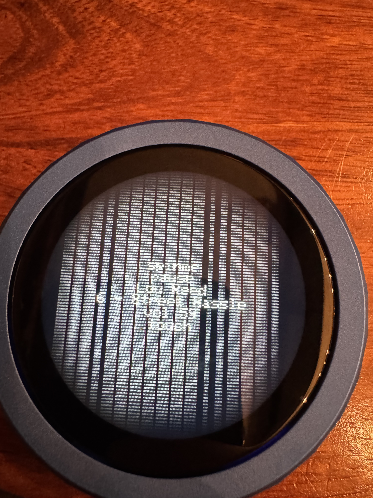
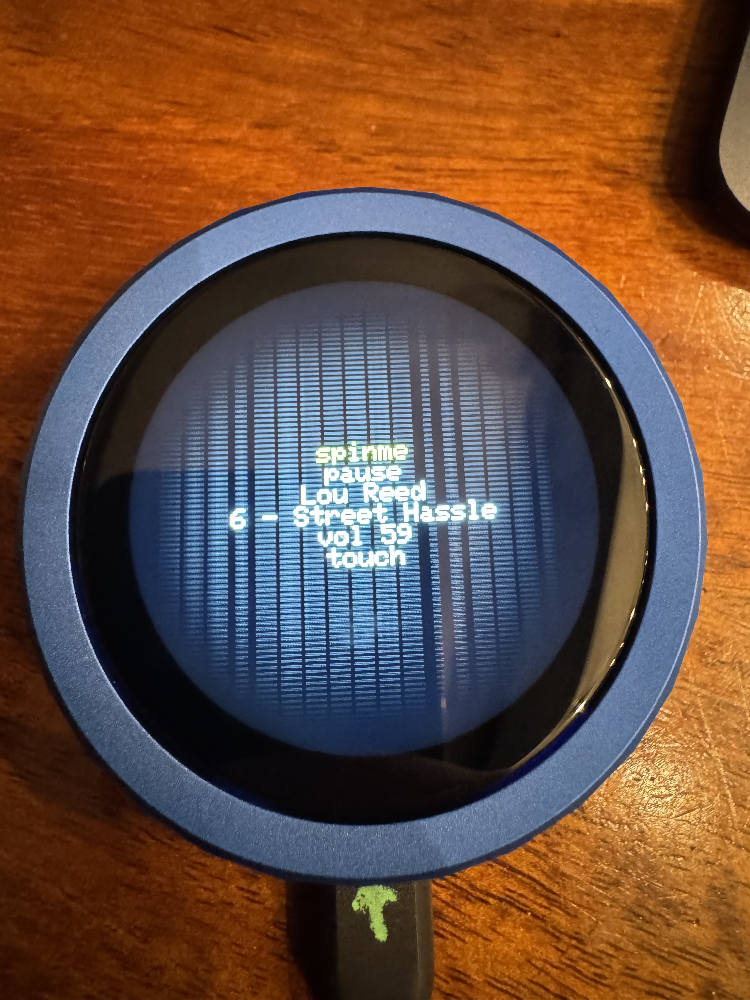

# Waveshare ESP32-S3 Knob 1.8: vertical pinstripes on the ST77916

## What you see

A round 360x360 glass (ST77916, QSPI, not RGB) paints readable text and
also a set of full-height columns. We called those columns pinstripes.
They survive a correct vendor init and a correct 16-bit pixel format.
They are dim once the bus framing is right, and a phone photo makes
them look darker than they are in the room.

Board: Waveshare ESP32-S3-Knob-Touch-LCD-1.8, S3 half.
MCU: ESP32-S3, 8MB octal PSRAM, 16MB flash.
Stack that produced the photos and the scores below: Arduino core
2.0.17 (ESP-IDF 4.4) and a small SPI panel driver, not Arduino_GFX and
not the ESP-IDF RGB LCD driver. Pixel clock in the checkpoint image
was 40 MHz. Commands are a 1-bit 32-bit word (`0x02`, then the
register). Pixel bytes use opcode `0x32` / RAMWR `0x2C` and quad mode
on the data only. Chip select stays low across the command and the
pixels. `COLMOD` is `0x3A` = `0x55` (RGB565).

The first photo is that readable-but-striped glass. The second is the
same glass after forcing `COLMOD 0x55` before and after the vendor
table. The type got clearer. The columns stayed.

Sending the command phase in quad mode made this worse (type became
illegible). Do not do that. This panel's commands are 1-bit. Only the
pixel payload is 4-bit.

Each fix below was flashed on its own, on top of that 40 MHz
checkpoint, and scored by looking at the glass. They were not combined
into one image.

## 10/10

### 1. Backlight off through reset and init

GPIO 47 is the backlight. GPIO 21 is reset. There is no third panel
power pin.

Hold the backlight low from boot, through the reset pulse (low 10 ms,
high, wait 150 ms) and through the whole vendor init table (that table
already ends in sleep-out, display-on, and MADCTL). Drive the backlight
high only after that, then draw.

Score: 10/10. Zero pinstripes. A black fill alone cannot prove this,
because a dead panel is also black. A short word in the top third
confirmed the pixels were real.

### 2. Bigger DMA chunks, still one RAMWR

The SPI DMA on this core accepts at most 32768 bytes per transaction
(`SPI_LL_DMA_MAX_BIT_LEN` is 18 bits). A 360x360 RGB565 frame is 259200
bytes, so it cannot be one burst.

16-row chunks are 11520 bytes. The 10/10 change uses 45 rows, which is
32400 bytes, the largest whole-row chunk under the cap. 360/45 is 8, so
the fill is 8 quad bursts under a single RAMWR with chip select held
the whole time.

Score: 10/10, with the backlight left high during init (the checkpoint
behavior). The columns were gone.

### 3. Do not draw while WiFi is associating

Flash and octal PSRAM share a bus on the ESP32-S3. `WiFi.begin` hits
that bus. A pixel DMA started in the same window comes out striped.

Wait until the connect attempt has returned (success or the timeout),
pause briefly, then draw. Do not paint a "wifi ..." frame before
`WiFi.begin`. If a one-shot draw is armed on that early call, the glass
sticks on `wifi ...` and the real result never replaces it.

Score: 10/10. The status text appeared after the join, with no
pinstripes. This was at 40 MHz, 16-row chunks, backlight high during
init.

## 8/10, and why it flickers

Drop the QSPI clock from 40 MHz to 20 MHz. Then try 10 MHz. Leave
everything else at the checkpoint (16-row chunks, backlight high during
init, redraws still running).

Both clocks scored 8/10. The pinstripes were gone. The picture
flickered, and the flicker was the same at 20 MHz and at 10 MHz. The
flicker is worse than a faint pinstripe.

The panel scans its own framebuffer while the host is still writing it.
This firmware repaints the full 360x360 frame on a timer and on encoder
pin changes. At 40 MHz that rewrite finishes before it reads as motion.
At 20 MHz and at 10 MHz the same rewrite spans the panel's scan, so the
glass flashes. Going slower again did not remove the flash. Prefer a
40 MHz clock plus one of the 10/10 changes above.

## Do not chase these

Forum posts about HSYNC, HBP, HFP, `avoid_tearing`, and RGB bounce
buffers are about a parallel RGB panel (often ST7701S or EK9716). This
knob has no porch pins. The ST77916 is a QSPI memory display.
