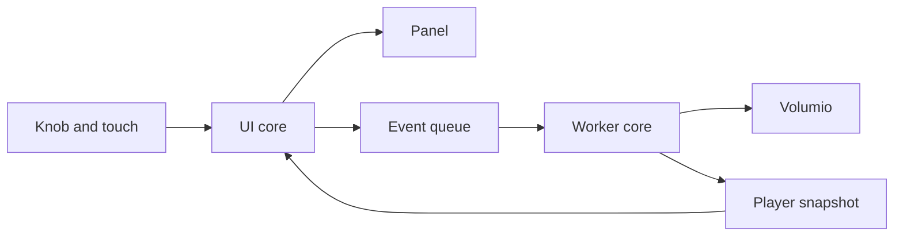
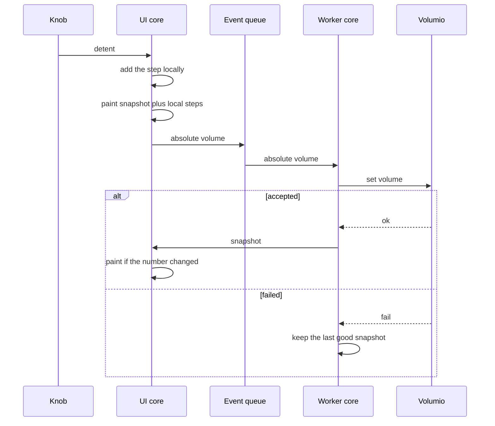
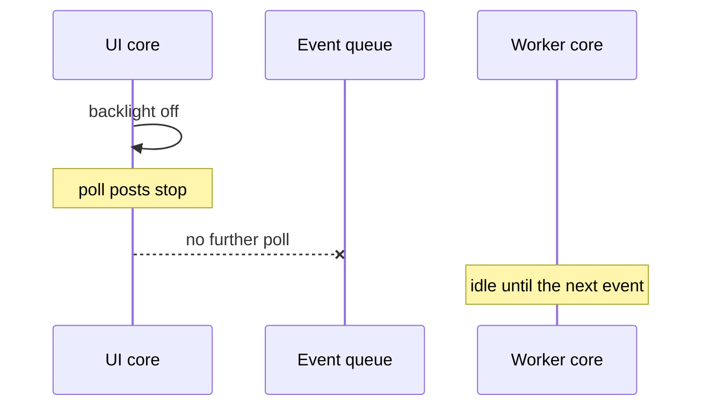

# Two cores: glass and Volumio

The UI core paints and collects input. The worker core talks to Volumio.
They share a player snapshot and an event queue. The UI core never calls
HTTP, DNS, or WiFi. The worker is the only application task that opens a
socket.

The player snapshot is the last good status, artist, title, and volume.
A failed poll or volume write leaves those fields as they are. Failure is
not a status string on the glass.

While the backlight is on, the UI core posts a poll about once a second.
After the backlight turns off, it posts no polls. A run of knob steps is
one coalesced absolute volume on the queue. Toggle is its own event.

The UI core keeps unsent steps locally and paints them before the worker
sends. A poll result does not replace volume while unsent steps are still
outstanding. The worker resolves `miniDSP-SHD.local` once and reuses the
address until a connect fails.

## Volume turn

The glass updates from the local step count. The worker sends one absolute
volume and publishes a snapshot only when Volumio accepts it.

## Poll while the glass is lit

```mermaid
sequenceDiagram
    participant UI as UI core
    participant Q as Event queue
    participant W as Worker core
    participant V as Volumio

    Note over UI: backlight on
    loop about once a second
        UI->>Q: poll
        Q->>W: poll
        W->>V: getState
        alt response
            V-->>W: status, artist, title, volume
            W->>W: store the snapshot
            W->>UI: snapshot
            UI->>UI: paint the diff
        else failed
            V-->>W: fail
            W->>W: leave the snapshot
        end
    end
```

## Backlight off

Wake is the reverse. A rising backlight posts one poll immediately, then
the one-second loop runs again until the glass goes dark.
