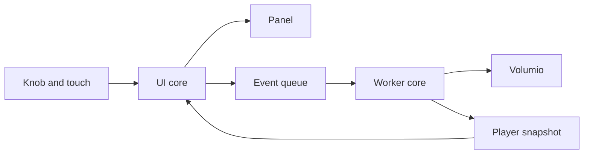
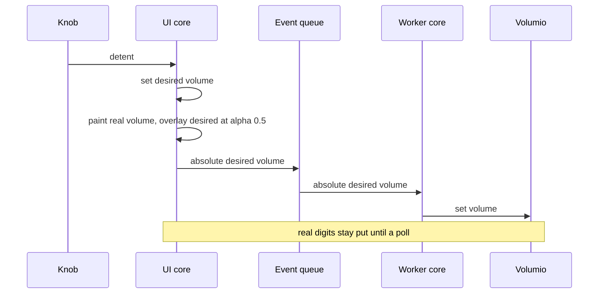
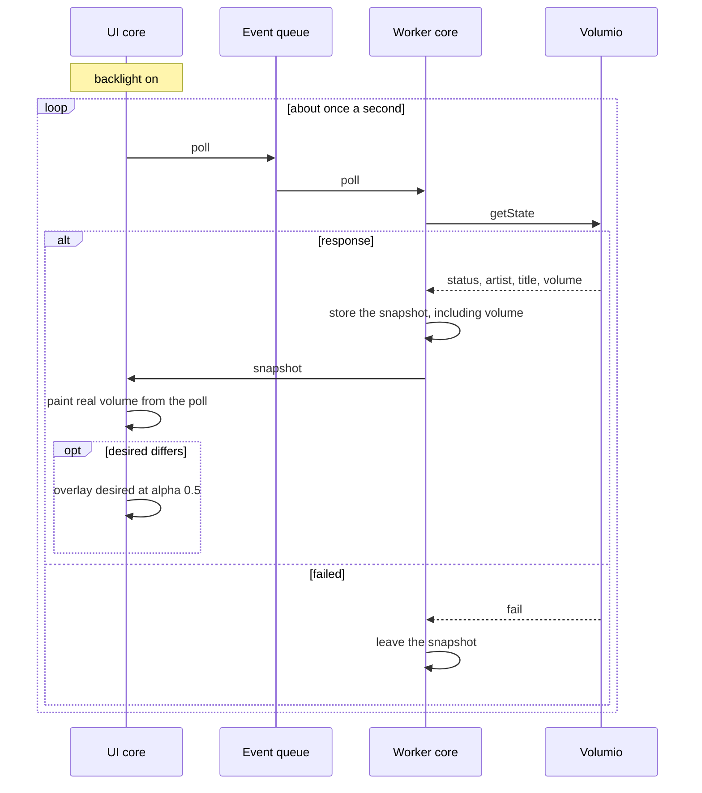
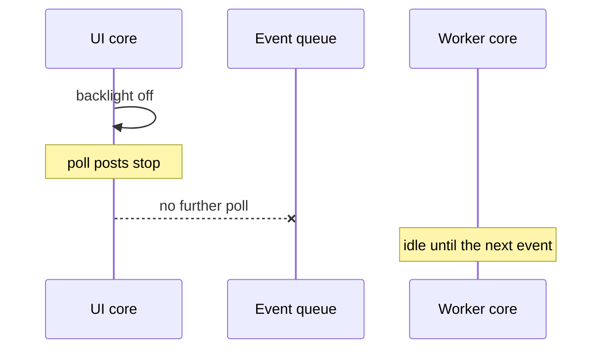

# Two cores: glass and Volumio

The UI core paints and collects input. The worker core talks to Volumio.
They share a player snapshot and an event queue. The UI core never calls
HTTP, DNS, or WiFi. The worker is the only application task that opens a
socket.

The player snapshot is the last good status, artist, title, and volume.
Volumio is the source of truth for volume. A poll writes that volume into
the snapshot every time it succeeds. A failed poll leaves the previous
snapshot in place. Failure is not a status string on the glass.

The UI core also keeps a desired volume: the absolute level the knob is
aiming at. With no outstanding turn, desired equals the polled volume.
Each detent changes desired immediately. Desired and polled volume diverge
for the short time until a later poll reports the level Volumio reached.
The UI core posts one coalesced absolute volume for that desired level.
Toggle is its own event.

The real volume is drawn in the normal ink. While desired differs, the
same line is drawn again in a second color at alpha 0.5, on top of the
real digits. When the polled volume equals desired, only the real volume
is drawn.

While the backlight is on, the UI core posts a poll about once a second.
After the backlight turns off, it posts no polls. The worker resolves
`miniDSP-SHD.local` once and reuses the address until a connect fails.

## Volume turn

The real digits stay on the last polled volume. The desired digits are
the overlay. The worker asks Volumio to move. A later poll is what moves
the real digits.

## Poll while the glass is lit

## Backlight off

Wake is the reverse. A rising backlight posts one poll immediately, then
the one-second loop runs again until the glass goes dark.
