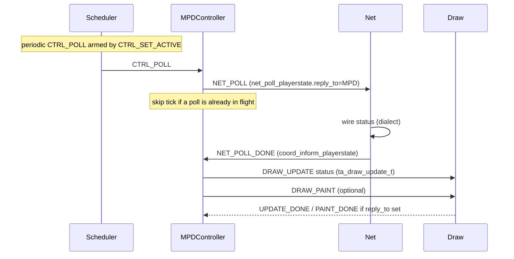
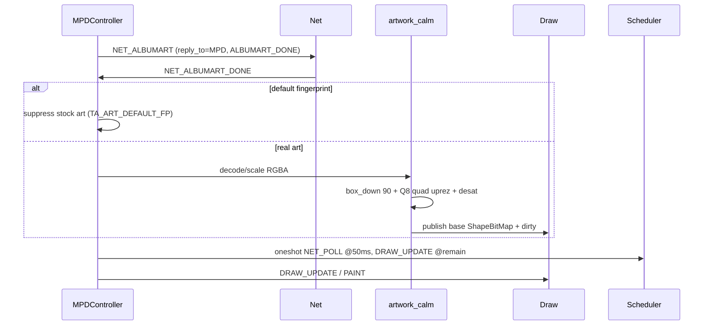
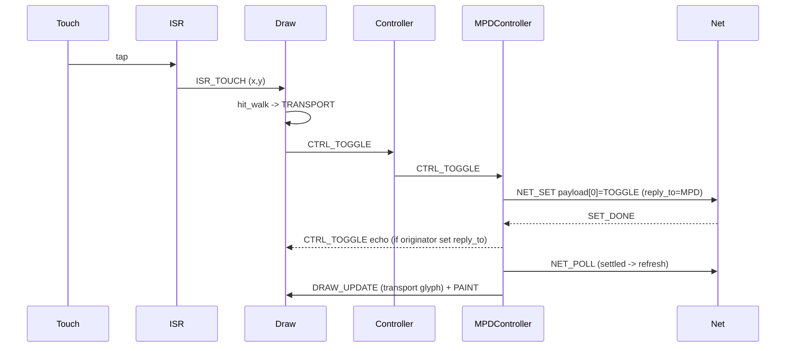
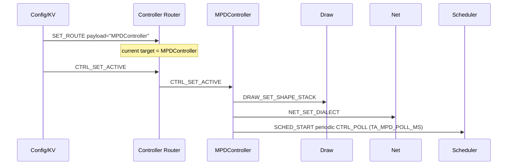

# spinme TaskActor exposition

## Authority

While fabric tickets are in play, those **todos are the design source of
truth** for both this document and the code. Update EXPOSITION and
implementation to match the todo (Body / Notes / WorkItems), not the reverse.

| Ticket | Owns (design) |
|--------|----------------|
| `todo:afc1dc50` (done) | Dead-simple KV layout + allocator, boot roster/load/`init`/`exit`, USB-only base loader, Net HTTP REST KV set / OTA payloads. Host path shipped; ELF map still a stub |
| `todo:15b92eaa` (groom) | Log TaskActor (sample/buffer/off-device drain), universal `ta_all_*` messages, Net NTP; **consumes** KV (does not redefine storage) |

Later, if code drifts from a closed ticket, **sync EXPOSITION to the code**
(as-built fidelity). Do not treat a stale EXPOSITION as design authority
over an open ticket.

Shipped baseline: host C99 suite + Waveshare TaskActor boot
(`todo:3135a46a`, merged). Directional PLAN (Rotary / MPDVolume /
ownership): [`PLAN.md`](PLAN.md). Host how-to:
[`host/README.md`](host/README.md). Board checklist:
[`host/SMOKE.md`](host/SMOKE.md).

This document is the event and shape catalog: registered TaskActors, event
types and bodies, completions, Draw shapes, ISR path, plus boot/KV/OTA
contracts ratified on the tickets above. Section 9 separates shipped code
from todo-ratified gaps still in flight.

## KV image and boot (`todo:afc1dc50` + sorted typed entries)

One writable KV image, prepopulated by `ta_kv_install_factory`. Entries are a
packed little-endian linked list kept **sorted by key**. `next` is a byte
offset from the image base (need not be adjacent). 0 means empty or end; a
4-byte head at offset 0 holds the first pointer. New entries use first-fit
holes; there is no compacting GC.

Each entry: `entrylen`, `next`, `keylen`, `key[]`, `valueinfo` (type in high
3 bits), `value[]`. Types: smallint `000`, int32 `001`, string `011`, blob
`100`, bool `111` (see `ta_kv.h` / `TA_KV_VTYPE_*`). Untyped `ta_kv_put` stores
a blob. Typed helpers: `ta_kv_put_bool` / `smallint` / `i32` / `string` /
`blob`.

`actors_to_start` is newline-separated actor names. Each name is also a key
whose blob is that actor's image. The base bin loader stays USB-only. The
image init loader is `ta_boot_from_kv`: roster, blob, stub load (non-empty
blob; ELF map not yet), `ta_actor_init`. `ta_actor_exit` is the inverse
(stop the loop, unregister). `ta_boot_exit_all` then boot again is the reload.

Net's OTA intake is `ta_net_kv_http_put` (`PUT /kv/<key>`): upload a
TaskActor **code** blob (or a config string) with `Content-Length` into
`ta_kv_put`. After a code put, `ta_boot_exit_all` and `ta_boot_from_kv`
reload the roster so the new image runs.

Net also serves HTTP-only on port 80: `POST /event/<taskactor>/<eventname>`
(`ta_net_http_event`). Query and/or form body are parsed as
`x-www-form-urlencoded` (body keys override query). Net enqueues the event
with a fresh `session_id`, blocks up to 5s for `TA_EV_NET_HTTP_REPLY`
(`ta_net_http_reply_t`), and returns that status/body; unknown actor -> 404;
timeout -> 201. mDNS advertise is Scheduler-timed (`ta_net_mdns_advertise`).
KV updates will ride this event path next.

## Log (`todo:15b92eaa`)

`ta_all_broadcast_perform_init` posts `TA_EV_ALL_PERFORM_INIT` to every
registered actor. Async replies use `TA_EV_ALL_INFORM_RESULT`.

Log collects `ta_log_accept` lines (`emit_time` + message) in a large buffer
(default small on host; up to ~128 KiB via KV `log_buffer_kb` smallint). A full
buffer, or an empty tick near the end of `log_cadence_s` (smallint, default
300), calls the Net send callback with `logtarget` (string; falls back to
`log_receiver_url`) and clears even if send fails. Target is QuLog/syslog
compatible (`ta_log_format_syslog`). On init, Log applies those KV settings and
refreshes the URL via inform.

---

## 1. Event envelope + typed body (normative shape)

**Source of truth:** `spinme/taskevent/` (Python). Every event is a
`TaskEvent` subclass with:

| Codec | API | Notes |
|-------|-----|-------|
| Packed LE binary body | `write_binary` / `read_binary` | Portable wire / ESP32-friendly; field order matches C members |
| C struct typedef | classmethod `to_c_struct()` | Emits `typedef struct { ... } ta_*_t;` for the type |
| C literal | instance `to_c_literal()` | Compound-literal text for one object's value |
| Text | `write_text` / `read_text` | `event=` / `type_id=` / `field=` lines |
| Form | `to_form` / `from_form` | `application/x-www-form-urlencoded`; flat events only (may raise); lists = repeated keys |

`EventEnvelope` wraps `src` + `session_id` + `enqueue_time_ms` + body.
Host body typedefs are generated into `host/ta_event_bodies.gen.h` by
`taskevent/gen_c_header.py` and included from `host/ta_event.h` (**passed by
value** in MVP). ABI padding may differ from the packed LE wire body. Update
Python first, regenerate the `.gen.h`, then this doc.

### Common header (every queue slot)

`reply_to` is **not** on the common header (and is the exception, not the
default -- see Completions). Receipt time is.

```c
#define TA_NAME_MAX 24
#define TA_TEXT_MAX 96

typedef uint16_t ta_event_type_t;
typedef uint32_t ta_session_id_t;
typedef uint32_t ta_time_ms_t; /* ms; host monotonic / device esp_timer */

typedef struct ta_event_envelope {
    char src[TA_NAME_MAX];
    ta_session_id_t session_id;
    ta_time_ms_t enqueue_time_ms; /* stamped by queue owner on push */
    ta_event_t event;             /* tagged body; see below */
} ta_event_envelope_t;
```

| Field | Role |
|-------|------|
| `src` | Producer actor name |
| `session_id` | Correlates a multi-step conversation |
| `enqueue_time_ms` | Filled by the **queue owner** on arrival; dwell = now - enqueue |
| `event` | Discriminated body (`type` + union) |

### Typed body (`ta_event_t`)

Naming: `ta_<recipient>_<verb>_<noun>_t` (recipient namespace / actor face),
matching `taskevent.types` class names (`LogEmitLine` <->
`ta_log_emit_line_t`). No byte-blob / `legacy` arm -- every op has a named
union member in `host/ta_event.h` (Net poll/set/albumart, Draw
update/paint/scroll/text/informs, ControlEvents, Scheduler start/tick, ISR
touch/rotary, Logger line, ...).

POLL_DONE carries `coord_inform_playerstate` (volume/playing filled today;
artist/album/song when Net has them).

### Events only (no fn ptrs)

All TaskActor communication is **events** -- requests, responses, and
informs. UI (touch / rotate) and Scheduler produce events; actors post
events to look up Config/KV, drive Net, and update Draw. There are no
function-pointer callbacks on the wire.

**Who gets a response?** The **event contract** decides:

- **Default:** if the contract says there is a response, it goes to
  envelope **`src`** (the sender). Response `type` / body are implied by
  the request (e.g. POLL -> `TA_EV_NET_POLL_DONE` with
  `coord_inform_playerstate`).
- **No response:** many contracts fire-and-forget (or only produce
  side-effect events to other actors). Example: a rotary turn may post
  one event to Net (update player volume) and another to Draw (target
  volume chrome) and send **nothing** back to the originator.
- **Response and side-effects:** allowed -- one DONE/inform to `src`
  plus other posts (Draw update, Log, ...).
- **`reply_to` is the exception:** only when the completion must land
  somewhere other than `src` (true proxy). Prefer omitting it; as-built
  code still carries `reply_to` on some request bodies until migrated.

Scheduler arms use `ta_sched_start_t` (`fire_to` + `fire_type`) -- that is
the timer's **fire destination**, not a completion `reply_to`.

### Interaction sketch (names)

As-built registry name for the face that owns player model + Net dialect
policy is **`MPDController`** (behind the **Controller** EventRedirector).
PLAN/chat may say **Coordinator** for that role -- same slot until renamed.

```text
Scheduler --CTRL_POLL--> Controller --> MPDController
MPDController --net_poll_playerstate (src=MPD)--> Net
Net --POLL_DONE / coord_inform_playerstate (to src)--> MPDController
MPDController --draw_inform_songinfo / volume / currpos--> Draw
```

Rotary path (PLAN): ISR -> Rotary redirector -> MPDVolume posts **side
effects** (Net SET + Draw inform target volume) and typically **no**
response to the ISR/Draw originator.

### Foundation type ids

| Type | Value | Meaning |
|------|-------|---------|
| `TA_EV_NOP` | 0 | No-op (empty body) |
| `TA_EV_LOG` | 1 | `ta_log_emit_line_t` |
| `TA_EV_SET_ROUTE` | 2 | `ta_ctrl_set_route_t` (target name) |

---

## 2. Plumbing (not TaskActors, but every post goes through them)

### Registry (`ta_registry`)

| API | Role |
|-----|------|
| `ta_registry_register(name, enqueue_fn)` | Bind actor name to enqueue |
| `ta_registry_lookup(name)` | Get fn or NULL |
| `ta_registry_post(name, ev)` | Lookup + call enqueue (mutex not held across handler) |

### Queue (`ta_queue`)

MP/SC (host pthread stand-in; device FreeRTOS). Circular buffer of
`ta_event_envelope_t`.

| API (as-built) | Role |
|----------------|------|
| `ta_queue_push` | Producer; stamps `enqueue_time_ms`; drop if full (`drops++`) |
| `ta_queue_peek_wait` / `try_peek` / `pop` | Consumer FIFO head |

#### Ordering guarantee (normative -- one rule only)

An event is **fully processed before any outgoing message it generates**
is visible to other actors (handler runs to completion, then posts).

There is **no** FIFO requirement among *unprocessed* messages on one
actor's queue: any still-queued envelope may be taken next. Causality
between actors comes only from the "process before emit" rule above.

#### Selective take (normative; degraded / filter)

When the consumer processes a slot that is **not** the front, it
**swaps** that slot with the front, then advances head (same as a
normal pop of the chosen message). Remaining order of other pending
slots is otherwise unchanged.

**Scan API:** `ta_queue_try_peek_verb` / `ta_queue_try_take_verb` walk
pending slots oldest-first with a match callback (e.g. only informs while
degraded). Take swaps the match with the front, then pops. No match =>
caller idles until a push. FIFO `peek`/`pop` head remain for normal drain.

Separate `ta_shape_lock_*` for shape/pixel protocol (not the queue mutex).

### Init + TaskActor lifetime (normative; `todo:afc1dc50`)

**Base bin loader** (USB-wired physical update only; not OTA'd): brings up
enough of the image to run the **small init loader**.

**Image init loader** boot procedure:

1. Locate the **KV** region (prepopulated by the static build; writable).
2. Get the **start-roster** key -> list of TaskActor **names**.
3. For each name: get that name's KV blob -> **load** (ESP flash map/cache
   where it already helps) -> call the actor's **`init()`** entry point.

**Exactly two loadable entry points (v1):**

| Entry | Role |
|-------|------|
| `init()` | Local setup; **register** name in the registry; start forever event loop (never returns until exit). |
| `exit()` | Inverse: leave the loop; **unregister** / remove from registry; release what init acquired. |

Reload / OTA after KV mutation: **`exit()` all** running actors, then run the
boot procedure again on the (possibly new) roster -- or reboot into the same
init loader.

As-built host still uses a sync entry list (`ta_init_add_entry` /
`ta_init_run_entries` + `*_start()` register then return). Treat
roster/load/`init`/`exit` as ticket-normative until implemented.

### Degraded / filter mode (normative)

Actors may run **degraded** while waiting on outside setup (e.g. config
get replies, Net dialect ready). In degraded mode the actor **filters**
incoming queue messages:

- Accept and handle the informs / replies needed to finish setup.
- Defer (leave queued) everything else via selective take: only the
  accepted message is swapped out; others stay until the actor leaves
  degraded mode and drains normally.

Once required outside info is in hand, the actor leaves degraded mode
and processes the full queue (any order among pending, still subject to
"process before emit").

### Config / KV (ours; `todo:afc1dc50`)

**One store** -- not a parallel NVS + SPIFFS + custom trio for the same job.

**Layout (sorted typed):** singly linked list of packed entries, keys ascending,
O(n) get:

```
entry { entrylen; next; keylen; key[keylen]; valueinfo; value[...] }
```

`valueinfo` high 3 bits = type (bool/smallint/int32/string/blob); see
`host/ta_kv.h`.

**Prepopulated but writable:** the static build emits a factory KV image
(default roster + per-name actor blobs). Runtime mutates the same region.

**Allocator:** KV owns placement for (possibly large) blobs; replace/delete
leaves **holes**; v1 is **first-fit**. Compacting GC deferred until first-fit
hurts.

**Well-known keys (boot + runtime):**

| Key | Default (factory image) | Consumer at startup |
|-----|-------------------------|---------------------|
| `actors_to_start` | `Draw\nNet\n` | `ta_boot_from_kv` |
| Per-name actor blob | e.g. `Draw`=`draw-v1` | boot stub load |
| `current_controller` | `MPD` | Router / Config |
| `log_receiver_url` | `http://gmk.local/logs` | Log init |
| `mpd_host` | `miniDSP-SHD.local` | player_http DNS |
| `ntp_host` | `pool.ntp.org` | Net SNTP (`configTime`) |
| `timezone` | `EST5EDT,M3.2.0/2,M11.1.0/2` | Net SNTP (`TZ` / `tzset`) |
| `screen_blank_s` | `30` | Draw idle backlight-off |
| `title_scroll_step` | `2` | Draw title ox step (px) |
| `title_scroll_ms` | `40` | Scheduler scroll arm period |

Seeded by `ta_kv_install_factory` -> `ta_runtime_cfg_put_factory`.
`ta_runtime_cfg_load` copies into a process cache (missing key => default).

`timezone` is a POSIX TZ string (not a bare UTC offset) so DST rules stay with
the zone. A future `timezone_offset_min` key is optional if a UI only edits
minutes.

**Net HTTP KV set:** Net owns the on-device REST intake for both **TaskActor
code** and runtime config strings (`ta_net_kv_http_put`):

```text
PUT /kv/<key>
Content-Length: <n>

<n bytes of body>
```

Base **bin** loader (whole firmware) stays USB-only; it is not replaced by
this path.

### Piecemeal **code** upgrade (TaskActor images via `PUT /kv/<key>`)

Each roster name is also a KV key whose blob is that actor's **loadable
code image** (ELF or platform image once mapping works; stub bytes on host
today). Upgrading one TaskActor means replacing that one blob over HTTP,
then reloading actors -- not reflashing the whole device.

```text
# Example: replace Draw's code only
PUT /kv/Draw
Content-Length: <sizeof draw image>
<draw image bytes>

# Then on device (or via a follow-up control):
ta_boot_exit_all()
ta_boot_from_kv()    # re-reads actors_to_start; loads each name's blob; init
```

**Rules:**

1. **One actor at a time.** `PUT /kv/Draw` does not touch `Net`,
   `Scheduler`, or config keys. After exit-all + boot, only the new Draw
   image is what changed in the running set (other blobs reload unchanged).
2. **Key == registry / roster name.** The body is opaque code for that
   actor. Config keys (`mpd_host`, `timezone`, ...) use the same REST face
   but carry short strings, not executables.
3. **Roster edits** (`PUT /kv/actors_to_start`) add/remove which names boot;
   each name still needs its own code key if it is to load.
4. **Reload barrier.** A successful code PUT stores the blob; it does not
   hot-patch a running task. `exit` all, then `boot_from_kv`, is the
   activation step (can be automatic after PUT later).
5. **Factory reset** rewrites roster + default config (+ tiny stub actor
   blobs). It is the recovery path if a bad image bricks one actor.

**Config vs code on the same API:** same `PUT /kv/<key>`, different key
classes. Code keys are actor names on the roster; config keys are the
well-known settings table above. Config can apply on
`ta_runtime_cfg_load` / `perform_init` without exit-all; **code** always
needs the boot barrier.

**As-built gaps (section 9):** blob size cap is still small for real ELF;
loader map/relocate is stubbed on device. The REST + KV + exit/boot loop is
the intended piecemeal code-upgrade shape.

---

## 3. TaskActors and event APIs

Registered names and ownership:

| Registry name | Constant | Source | Owns type range |
|---------------|----------|--------|-----------------|
| `Logger` | `TA_LOGGER_NAME` | `ta_logger` | uses `TA_EV_LOG` / accept+drain (`todo:15b92eaa`) |
| `Config` / KV | (TBD `TA_CONFIG_NAME`) | dead-simple KV store + actor face | owns packed LL KV + first-fit (`todo:afc1dc50`); get/inform for peers |
| `Draw` | `TA_DRAW_NAME` | `ta_draw_events` | `0x200..` (6 oclock debug -> Log) |
| `Net` | `TA_NET_NAME` | `ta_net_events` | `0x300..` (+ HTTP REST KV set; NTP) |
| `Controller` | `TA_CONTROLLER_NAME` | `ta_router` | `TA_EV_SET_ROUTE` + forwards ControlEvents |
| `MPDController` | `TA_MPD_NAME` | `ta_controller` | consumes ControlEvents |
| `SonosController` | `TA_SONOS_NAME` | `ta_controller` | stub, same surface |
| `Scheduler` | `TA_SCHED_NAME` | `ta_sched_events` | `0x500..` |

ISR mail is **not** a registry actor; it only accepts `0x100`/`0x101` into
Draw's ingress.

Helpers that are **not** actors: artwork (`ta_artwork_*`), hit walk
(`ta_react_*`), follow chrome builder, shape/text/viewport/under-image math.

---

### 3.1 Logger

**Start:** `ta_logger_start()` registers `Logger`.

| API | Role |
|-----|------|
| `ta_logger_enqueue` | Accept events |
| `ta_logger_emit(...)` | Build `TA_EV_LOG` and post |
| `ta_logger_set_policy` / `policy` | Per-severity: DROP / NVM / EXTERNAL |
| `ta_logger_drain` | Process queued logs |

**`TA_EV_LOG` body:** `ta_log_emit_line_t` (`severity`, `tag`, `text[TA_LOG_TEXT_MAX]`).

**Callback:** none required; emit is one-way unless a future policy adds ack.

---

### 3.2 Draw

**Start:** `ta_draw_start()`. Draw is the **sole glass owner**: `ta_draw_events`
dispatches into `ta_draw_glass` (follow chrome state, text slots, status,
idle/backlight) which runs update / phase1 / phase2 and executes the push list
through a `ta_glass_backend_t` (host fake or `panel_push_pack66` on device).
Nothing else paints. Draw's queue is MP/SC (`ta_draw_bind_queue`); the Draw
task alone pumps it with `ta_draw_pump(mails, n)`, which also drains the ISR
mails first.

| Type | Value | Body | Completion |
|------|-------|------|------------|
| `TA_EV_DRAW_UPDATE` | 0x200 | `ta_draw_update_t` (`kind` CADENCE/STATUS/BASE_DIRTY; status fields 0xFF=keep; optional `reply_to`) | paints when changed; `reply_to` -> `UPDATE_DONE` |
| `TA_EV_DRAW_PAINT` | 0x201 | `ta_draw_paint_t` (optional `reply_to`) | -> `PAINT_DONE` |
| `TA_EV_DRAW_REACT_TOUCH` / `TA_EV_ISR_TOUCH` | 0x202 / 0x100 | `ta_draw_react_touch_t` / `ta_isr_touch_t` (`x`,`y`) | hit walk -> ControlEvent; dark: wake only |
| `TA_EV_DRAW_REACT_ROTATE` / `TA_EV_ISR_ROTARY` | 0x203 / 0x101 | `ta_draw_react_rotate_t` / `ta_isr_rotary_t` | `CTRL_VOLUME` REL to Controller |
| `TA_EV_DRAW_SET_SHAPE_STACK` | 0x204 | empty | installs follow chrome + first full paint |
| `TA_EV_DRAW_LOG` | 0x205 | empty | none |
| `TA_EV_DRAW_SCROLL_OX` | 0x206 | `ta_draw_scroll_ox_t` (`has_ox=0` => step; else absolute `ox`) | repaint title viewport |
| `TA_EV_DRAW_SET_TEXT` | 0x207 | `ta_draw_set_text_t` chunks (`FIRST`/`LAST`); helper `ta_draw_post_text` | rebuild L2R on LAST, paint |
| `TA_EV_DRAW_UPDATE_DONE` | 0x210 | empty | n/a |
| `TA_EV_DRAW_PAINT_DONE` | 0x211 | empty | n/a |

Text fields: `TA_DRAW_TEXT_ZONE/ARTIST/ALBUM/TITLE`. Volume and transport
lines are derived from status (desired shown while it differs from polled;
`play`/`stop`). Clock digits come from the backend wall clock or uptime.

Glass pipeline per paint (`ta_glass_paint`):

1. **`ta_draw_update`** -- dirty Shape/UILayout flags only; may run
   `TA_UPD_REPRESENT_TIME` for clock digits. Never touches `*pixels`.
2. **`ta_draw_phase1`** -- farthest->nearest rebuild dirty local pixmaps.
   Text paper is transparent, so each dirty L2R/Viewport composites the
   matching crop of the base (artwork) bitmap under its glyphs
   (`ta_phase1_opts_t.base_shape_idx`); no panel-sized shadow exists.
   Viewports blit the child at `-ox` and again at `period - ox` so the
   scroll wraps with `TA_PHASE1_SCROLL_GAP`.
3. **`ta_draw_phase2`** -- nearest->farthest coverage cull; emit exterior
   push list; clear dirty. Draw executes the list **farthest-first** so a
   farther rect never overpaints a nearer one.

Idle: each cadence UPDATE without input counts; after
`TA_GLASS_SCREEN_OFF_S` the backend backlight goes off and paints are
skipped. The next touch wakes (no hit-test) and repaints everything.

---

### 3.3 Net (+ MPD dialect)

**Owns the TCP/IP / HTTP socket plane** (resource owner; not an
EventRedirector). Device: `player_http` + `ta_net_backend` seam. Host:
immediate stub replies on enqueue; `ta_net_mpd_*` coalesces volume and
defers POLL/ALBUMART until tick.

#### Concurrency (normative)

- **Outbound client work may be sequential.** MPD poll/set/albumart, NTP,
  and any other Net-initiated client requests share one outbound lane
  (queue / one-in-flight). Fine to wait for getState before starting NTP.
- **Inbound HTTP: one active client at a time.** Excess peers stay on the
  listen backlog (or are not accepted yet). No multi-client HTTP
  multiplexing in MVP.
- **Inbound must not block behind outbound.** Serving the one accepted
  HTTP client must progress even while the outbound lane has a getState
  / NTP / albumart in flight.

#### Redesign sketch (two select slots -- static)

Not a free-form connection pool. Net owns a **fixed two-slot** wait set
(plus the listen fd when idle on the server side):

```text
  listen_fd          -- Config HTTP server (always)
  in_fd  (0 or 1)    -- at most one accepted HTTP client
  out_fd (0 or 1)    -- at most one outbound client (Volumio / NTP / ...)

  each Net turn:
    select/poll on { listen_fd?, in_fd?, out_fd? }  -- <= 3 fds, static
    if listen readable and in_fd empty: accept -> in_fd
    if in_fd ready: non-blocking read/write; on complete request
         -> Config event; on response done -> close in_fd (or keep-alive
         later); never wait on out_fd
    if out_fd ready: advance one outbound state machine step; on DONE
         -> registry post; take next queued outbound op if any
    if listen readable and in_fd busy: leave peer on backlog (do not accept)
```

All of that state is **statically allocatable** (three fd ints, two small
I/O buffers / parsers, one outbound op enum + reply_to/session). No
heap connection table for MVP.

As-built `player_http` is outbound-only and single-phase (no listen /
`in_fd`). Adding Config HTTP = add listen + `in_fd` beside the existing
outbound machine; do not fold server I/O into the outbound "busy" gate.

**NTP:** Net owns SNTP. After WiFi is up, `player_http` calls
`ta_net_sntp_after_wifi()` (device sets TZ + `configTime` to pool.ntp.org).
Draw still reads `time()`. Device smoke that the clock matches host ToD is
still open on `todo:15b92eaa`.

| Type | Value | Body | Completion |
|------|-------|------|------------|
| `TA_EV_NET_SET_DIALECT` | 0x300 | empty (MPD vs Sonos TBD) | none in stub |
| `TA_EV_NET_POLL` | 0x301 | `ta_net_poll_playerstate_t` (`reply_to`) | -> `POLL_DONE` |
| `TA_EV_NET_SET` | 0x302 | `ta_net_set_t` (`op` TOGGLE/VOLUME, `volume`, `reply_to`) | -> `SET_DONE` |
| `TA_EV_NET_ALBUMART` | 0x303 | `ta_net_fetch_albumart_t` (`path[TA_PATH_MAX]`, `reply_to`) | -> `ALBUMART_DONE` |
| `TA_EV_NET_POLL_DONE` | 0x310 | `ta_coord_inform_playerstate_t` (volume/playing today; 0xFF unknown) | n/a |
| `TA_EV_NET_SET_DONE` | 0x311 | empty | n/a |
| `TA_EV_NET_ALBUMART_DONE` | 0x312 | empty (bytes/fp TBD) | n/a |

MPD dialect also no-ops unsupported `TA_EV_CTRL_NEXT` / `PREV` when seen on
the Net side.

Device backend (`ta_net_player_bind.c`, the dialect edge): a `getState`
completion fills the POLL_DONE status payload via
`ta_net_backend_complete_ex`, posts artist/album/title to Draw with
`ta_draw_post_text`, and requests `NET_ALBUMART` when the artwork path
changes. MPDController adopts the polled volume into its model (unless a
SET is in flight), remembers `playing`, and posts `DRAW_UPDATE` status to
Draw on POLL_DONE, TOGGLE (optimistic flip) and VOLUME.

**Artwork calm (not an event):** after decode to RGBA, product path is
`ta_artwork_calm_rgba`: box-down to `TA_ART_LORES` (90), Q8 quadratic
B-spline 2D uprez, light desat. Default-art fingerprint
`TA_ART_DEFAULT_FP`. Album change helper
`ta_artwork_on_album_change` arms Scheduler oneshots (NET_POLL @ 50 ms,
DRAW_UPDATE @ time-remaining).

---

### 3.4 Controller Router + Controllers

**Router** registers as `"Controller"`. Only it handles `TA_EV_SET_ROUTE`;
everything else is forwarded **intact** (typed body + `session_id`) to the
current target name.

| Type | Value | Body | Notes |
|------|-------|------|-------|
| `TA_EV_SET_ROUTE` | 2 | `ta_ctrl_set_route_t.target` | sets route; not forwarded |

**ControlEvents** (posted to `"Controller"`, consumed by MPD/Sonos):

| Type | Value | Body | MPDController behaviour |
|------|-------|------|-------------------------|
| `TA_EV_CTRL_TOGGLE` | 0x400 | `ta_ctrl_toggle_t` (`reply_to` optional) | posts `NET_SET` TOGGLE; echoes originator on `SET_DONE` |
| `TA_EV_CTRL_VOLUME` | 0x401 | `ta_ctrl_volume_t` mode NONE/REL/ABS | model 0..100; change -> `NET_SET` volume; unchanged -> echo only |
| `TA_EV_CTRL_NEXT` | 0x402 | empty | counted only |
| `TA_EV_CTRL_PREV` | 0x403 | empty | counted only |
| `TA_EV_CTRL_SET_ACTIVE` | 0x404 | `ta_ctrl_set_active_t` | posts `DRAW_SET_SHAPE_STACK` + `NET_SET_DIALECT`; arms `CTRL_POLL` every `TA_MPD_POLL_MS`; optional echo |
| `TA_EV_CTRL_POLL` | 0x405 | empty | posts `NET_POLL` unless one in flight (`polls_skipped`) |

MPDController rules (`ta_controller.c`):

- **One SET in flight.** A second TOGGLE / VOLUME while a `NET_SET` awaits
  `SET_DONE` is coalesced: the volume model keeps moving, and on `SET_DONE`
  the pending toggle (first) or the latest level (second) is sent as one
  `NET_SET`. The latest originator's `reply_to` gets the echo.
- **Settled -> refresh.** When `SET_DONE` arrives with nothing queued, MPD
  posts one `NET_POLL` so chrome follows the player.
- **session_id** of the ControlEvent is carried on every Net post and echo.
- Controllers never touch `player_http`; the only Net path is the registry.
- Volume model seeds at `TA_MPD_VOL_DEFAULT` (50) until an absolute set
  or a `POLL_DONE` with known volume (`!= 0xFF`).

`SonosController` stays a counting stub (no Net traffic).

Names: `MPDController`, `SonosController`.

---

### 3.5 Scheduler

**Start:** `ta_sched_start()`. Fake time: `ta_sched_advance_ms` /
`TA_EV_SCHED_TICK` body.

| Type | Value | Body | Meaning |
|------|-------|------|---------|
| `TA_EV_SCHED_START` | 0x500 | `ta_sched_start_t` (`fire_to`, `fire_type`, `period_ms`, `flags`) | arm slot |
| `TA_EV_SCHED_STOP` | 0x501 | empty | clear all slots |
| `TA_EV_SCHED_TICK` | 0x502 | `ta_sched_tick_t.advance_ms` | advance fake clock and fire due slots |

Convenience arms (post START):

| API | Fire type | Period |
|-----|-----------|--------|
| `ta_sched_arm_clock_1hz(dst, session)` | `TA_EV_DRAW_UPDATE` (CADENCE) | 1000 ms periodic |
| `ta_sched_arm_scroll(dst, session, every_ms)` | `TA_EV_DRAW_SCROLL_OX` (`has_ox=1`, ox++) | periodic |
| `ta_sched_arm_oneshot(dst, session, delay, fire_type)` | caller-chosen | one-shot |
| `ta_sched_arm_periodic(dst, session, every_ms, fire_type)` | caller-chosen (MPD uses `TA_EV_CTRL_POLL`) | periodic |

Overdue policy: one fire, then `next = now + period` (no catch-up burst).
16 slots; oneshots preferred front of table.

---

### 3.6 ISR ingress (as-built: into Draw only)

Not a TaskActor. Types allowed on the FromISR path only. **PLAN** wants
rotary pooled time/delta into a **Rotary** EventRedirector (not Draw) --
see section 9; this table is still what ships today:

| Type | Value | Body |
|------|-------|------|
| `TA_EV_ISR_TOUCH` | 0x100 | `ta_isr_touch_t` (`x`, `y`) |
| `TA_EV_ISR_ROTARY` | 0x101 | `ta_isr_rotary_t` (`steps`, `vel_q8`) |

Any other type is **rejected** by `ta_isr_mail_push_from_isr` (no Wi-Fi,
paint, or Net from ISR). Capacity 8; full => drop + error log, never block.

---

## 4. Type range map (quick)

| Range | Owner |
|-------|-------|
| 0x000.. | Foundation (`NOP`, `LOG`, `SET_ROUTE`) |
| 0x100.. | ISR mail (`TOUCH`, `ROTARY`) |
| 0x200.. | Draw |
| 0x300.. | Net (+ DONE at 0x310..) |
| 0x400.. | ControlEvents (via Controller) |
| 0x500.. | Scheduler |

---

## 5. Shapes Draw supports

Shape table: `TA_SHAPE_MAX` 1024. UILayout points at a shape idx; only
UILayouts (plus chrome stack-compose) paint to glass.

### Tags (as-built)

| Tag | Value | Struct | Role |
|-----|-------|--------|------|
| `TA_SHAPE_TAG_BITMAP` | 1 | `ta_shape_bitmap_t` | Fixed pack66 pixmap (`w`,`h`,`*pixels`) |
| `TA_SHAPE_TAG_L2R` | 2 | `ta_shape_l2r_t` | Left-to-right composite of child bitmaps via shapepack |
| `TA_SHAPE_TAG_VIEWPORT` | 3 | `ta_shape_viewport_t` | Window over a child; `ox`/`oy` scroll |
| `TA_SHAPE_TAG_SWAP` | 4 | `ta_shape_swap_t` | N same-size children; show exactly one `active` |

Under-image / album art is a **BitMap** used as the panel base, not a fifth
tag.

### pack66 pixel word

```text
bits  0..5   R6
bits  8..13  G6
bits 16..21  B6
bits 24..25  A2   (0 = skip / transparent, 1..2 blend, 3 opaque)
```

Pseudo:

```
pack66(r,g,b,a) = (r&63) | (g&63)<<8 | (b&63)<<16 | (a&3)<<24
over(dst, src):
  if src.a == 0: return dst
  if src.a >= 3: return src
  return pack66( (src.rgb*src.a + dst.rgb*(3-src.a))/3 , a=3 )
```

### UILayout word (display list entry, not a Shape)

One `uint32_t`:

```text
bit 0        dirty
bit 1        pad
bits 2..11   x   (int10, 0..1023)
bits 12..21  y   (int10)
bits 22..31  shape idx (idx10, 0..1023)
```

`accept_hit[]` is a parallel `uint8_t` array (not packed into the word).

### Shapepack index packing (ShapeL2R `pack[]`)

Each pack word is a `uint32_t`. The **top 2 bits are the density tag**; the
**remaining 30 bits** hold tightly packed child shape idxs (low bits first).
Idx `0` is the stream terminator (`TA_SHAPEPACK_END`).

| Tag enum | Top2 | Name | Idx width | Max idxs / word | Idx bits used |
|----------|------|------|-----------|-----------------|---------------|
| `TA_PACK_TAG_6x5` | `00` | six x 5-bit | 5 | 6 | 30 (bits 0..29) |
| `TA_PACK_TAG_5x6` | `01` | five x 6-bit | 6 | 5 | 30 |
| `TA_PACK_TAG_4x7` | `10` | four x 7-bit | 7 | 4 | 28 (bits 0..27) |
| `TA_PACK_TAG_3x10` | `11` | three x 10-bit | 10 | 3 | 30 |

**6x5 explicit layout** (densest; glyph runs often use this when idxs < 32):

```text
uint32_t word:
  bits 31..30  tag = 00  (TA_PACK_TAG_6x5)
  bits 29..25  idx5   (6th child, slot 5)
  bits 24..20  idx4
  bits 19..15  idx3
  bits 14..10  idx2
  bits  9..5   idx1
  bits  4..0   idx0   (1st child, slot 0)
```

Encode pseudo:

```
encode(idxs[0..n), tag):
  bpi = {6x5:5, 5x6:6, 4x7:7, 3x10:10}[tag]
  ipw = {6x5:6, 5x6:5, 4x7:4, 3x10:3}[tag]
  while idxs remain:
    word = (tag & 3) << 30
    for slot in 0 .. ipw-1 while idxs remain:
      word |= (idx & ((1<<bpi)-1)) << (slot * bpi)
    emit word
  emit terminator: (tag & 3) << 30   # all idx fields zero
```

Decode one word: read tag from bits 31..30, peel `ipw` fields; if every
idx is 0, the word is end-of-stream.

### Pseudo: each shape kind

**BitMap**

```
bake(bitmap):  # already has pixels; phase1 no-op
paint(dst, ox, oy, bitmap):
  for each pixel p in bitmap:
    if p.a != 0: dst[ox+x,oy+y] = over(dst[...], p)
```

**ShapeL2R**

```
bake(l2r):
  clear l2r.pixels
  x = 0
  for idx in unpack(l2r.pack):           # stop at idx 0
    child = shape_table[idx]             # BitMap glyph etc.
    blit child at (x, 0) into l2r.pixels
    x += child.w + kerning_for_item
  l2r.w, l2r.h = computed size
```

**Viewport**

```
bake(vp):
  clear vp.pixels
  blit_base_crop into vp.pixels at window (ex,ey)   # optional under
  child = shape_table[vp.child_idx]
  blit child at (-vp.ox, -vp.oy) into vp.pixels
  if child.w > vp.w: also blit wrapped copy at period - ox
```

**SwapShape**

```
bind(swap):
  require all children same w/h and non-null pixels
  swap.pixels = alias of children[swap.active].pixels
set_active(i):
  swap.active = i; dirty; bind again
paint: same as BitMap using aliased pixels
```

### Chrome icon bitmaps (play / pause / arrows)

These are ordinary **BitMap** shapes filled by `ta_chrome_icons_*`, then
shown through follow slots TRANSPORT and NAV.

| Glyph | API | Size | Geometry | a2 |
|-------|-----|------|----------|-----|
| Play | `ta_chrome_icon_play_outline` | 90x90 | Three thick strokes: left vertical + two diagonals to a tip (hollow triangle outline) | body_a2 from caller |
| Pause (stop bars) | `ta_chrome_icon_pause_outline` | 90x90 | Two vertical rounded bars (outline strokes) | body_a2 from caller |
| Up arrow | `ta_chrome_icon_up_solid` | 60x60 | Filled triangle head + stem | always opaque a2=3 |
| Down arrow | `ta_chrome_icon_down_solid` | 60x60 | Filled triangle head + stem | always opaque a2=3 |

**Play / pause (center transport)**

- Placement: panel center (`(panel - 90)/2`).
- Meaning: tap toggles play/pause (`TA_FN_TRANSPORT_TOGGLE`).
- Desired glyph leads; ink a2 tracks poll agreement:
  - `a2=1` (`TA_CHROME_A2_PENDING`) while `playing != playing_polled`
  - `a2=2` (`TA_CHROME_A2_SETTLED`) when they agree (still translucent so
    track text shows through the strokes)
- Paint path: `ta_stack_compose_exterior` = base crop + follow text layers
  under TRANSPORT + icon, then one resolved push (never base-only wipe).

Play outline pseudo:

```
play_outline(px, w, body_a2):
  clear px to a=0
  left, right, top, bot, mid = margins of w
  stroke_seg(left,top -> left,bot, thickness w/10)
  stroke_seg(left,top -> right,mid, ...)
  stroke_seg(left,bot -> right,mid, ...)
```

Pause outline pseudo:

```
pause_outline(px, w, body_a2):
  clear px
  place two bar rects left/right of center
  stroke each bar's four edges (capsule look)
```

**Up / down (12 o'clock nav)**

- Placement: top center (`button_y`), **above** the SwapShape page content.
- Same hit box; glyph flips with mode:
  - **Selected**: solid **up** = enter choosing / back-out affordance
  - **Selecting**: solid **down** = commit the previewed Swap child
- Wired as `TA_FN_NAV` (not owned by SwapShape itself).

Up solid pseudo:

```
up_solid(px, w):
  clear; a2 = opaque
  fill_tri_aa(apex at top, base at mid)
  stroke_seg stem mid -> bottom
```

### Follow chrome slots

| Slot | Index | Hit? | Dynamic high-z? | Shape role |
|------|-------|------|-----------------|------------|
| BASE | 0 | no | no (paint-once) | BitMap album / disintegration |
| ZONE | 1 | no | no | L2R text |
| ARTIST | 2 | no | no | L2R text |
| ALBUM | 3 | no | no | L2R text |
| TITLE | 4 | no | yes (scroll) | Viewport over TITLE L2R; y centered on transport |
| VOLUME | 5 | yes | no | L2R text |
| TRANSPORT | 6 | yes | no | BitMap play/pause 90px |
| CLOCK | 7 | no | yes | L2R text |
| NAV | 8 | yes | no | BitMap up/down 60px |

Built by `ta_follow_chrome_build` / `ta_follow_chrome_place`.

### SwapShape modes

| Mode | Meaning |
|------|---------|
| Selected | Committed child (e.g. MPD follow page). No chooser ring. |
| Selecting | Overlay on; rotary steps `active`; down-arrow commits. |

Shapes do not hold function pointers. Interactive slots carry `fn_enum`;
`ta_wire_touch` / `ta_wire_rotary` switch on it.

### Pseudo: whole UI paint (follow page)

```
glass_paint():
  if swap.active != 0:
    push full-panel pixels of active swap child; return

  phase1(scene):                     # bake dirty L2R / Viewport / Swap bind
  pushes = phase2(scene)             # nearest-first dirty exteriors
  for push in reverse(pushes):       # farthest first on glass
    hdr = shape_table[push.shape]
    if hdr is TRANSPORT or NAV:
      composed = stack_compose(
        base_crop(exterior),
        blit each follow slot 1 .. top_slot-1,   # zone..volume under transport
        blit hdr icon at (0,0) with a2)
      push_rect(exterior, composed)
    else:
      push_rect(exterior, hdr.pixels)

stack_compose(dst, ex, ey, ...):
  blit base into dst
  for slot in ZONE .. (top_slot-1):
    blit shape_table[uilo[slot]] at (uilo.x-ex, uilo.y-ey)
  blit top icon with pack66 over
```

### Pixel-perfect PNG UI tests

`spinme/host/test_screenshots` loads device `glyphs.bin` +
`disintegration_360.rgba`, paints the 360 glass into
`build/ui_actual/`, and compares decoded RGB to goldens under
`spinme/screenshots/` (`main_mpd`, `main_playing`, `selecting_overlay`,
`kv_view`, `kv_edit`). Refresh: `SPINME_UI_UPDATE_GOLDEN=1`.

### Host unit tests (docstrings)

All live under `spinme/host/test_*.c`. Run via `make test` (or one binary
under `build/`). Each file's leading comment is the contract a fresh agent
should read first:

| File | Docstring |
|------|-----------|
| `test_actor.c` | Registers an actor on init and removes it on exit. |
| `test_all_init.c` | Broadcast perform_init delivers once to every registered actor. |
| `test_artwork.c` | Artwork pipeline: calm Q8 upscale to pack66, skip default art, oneshot album change. |
| `test_boot.c` | Boot walks KV roster, stub-loads each actor blob, calls init. |
| `test_controller.c` | Controller routes SetActive/ControlEvents to MPD or Sonos stubs. |
| `test_draw_events.c` | Draw event switch handles ops and async reply_to completions. |
| `test_draw_glass_contract.c` | Glass pipeline contract: update + phase1 + phase2 + under-image together. |
| `test_draw_glass_owner.c` | End-to-end: Draw owns glass -- ISR hit, MPD/Net status, paint pushes. |
| `test_draw_phase1.c` | phase1 bakes dirty L2R/viewport farthest-to-nearest (no LCD push). |
| `test_draw_phase2.c` | phase2 emits whole dirty exteriors, culls covered ones, clears dirty. |
| `test_draw_update.c` | update marks defs/dirty and shadow-propagates without rewriting pixels. |
| `test_event_envelope.c` | Envelope fields + typed event union round-trip (no sync RPC). |
| `test_follow_chrome.c` | Follow chrome: nine UILayout slots, paint-once vs high-z title/clock. |
| `test_hit_dispatch.c` | Hit walk on accept_hit slots posts ControlEvents through Router. |
| `test_input_isr.c` | Encoder gray/velocity decode; touch/rotary post into Draw ISR mail. |
| `test_isr_mail.c` | ISR mail ring accepts FromISR posts and drains into the Draw queue. |
| `test_kv.c` | NVM KV put/get copy-out and current_controller config key. |
| `test_kv_actor.c` | KV actor set then get replies with ta_all_inform_result to caller. |
| `test_kv_editor.c` | KV editor page lists records; fwd/back moves the selection. |
| `test_log_accept.c` | Log accept fills a fixed buffer then rejects further lines. |
| `test_log_drain.c` | Log drain sends, clears even on 502, skips empty ticks inside 4:30. |
| `test_log_init.c` | Log init KV-gets log_receiver_url; inform installs the drain URL. |
| `test_mpd_net.c` | Integration: Router->MPD->Net poll cadence with reply_to/session_id. |
| `test_net_events.c` | Net dialect/poll/albumart with reply_to and fake backend seam. |
| `test_net_kv_http.c` | PUT /kv/KEY then exit-all+boot picks up the new actor blob. |
| `test_net_mpd.c` | MPD Net dialect: poll/set coalesce and albumart reply_to. |
| `test_net_sntp.c` | Net SNTP after_wifi seam is recorded for the timesource handoff. |
| `test_queue.c` | Multi-producer/single-consumer queue: peek/handle/pop, full-drop, shape lock. |
| `test_registry_logger.c` | Registry posts; Init list starts Logger; log sample/reject policies. |
| `test_router.c` | SetRoute(MPD) delivers events to MPD stub; Sonos stub stays quiet. |
| `test_sched_cadence.c` | Scheduler: 1Hz clock, title scroll ox, one-shots under fake time. |
| `test_sched_events.c` | Scheduler start/stop fires ticks with session_id under fake time. |
| `test_screenshots.c` | Pixel-perfect glass UI vs PNG goldens in ../screenshots/ (see file for golden refresh). |
| `test_shape_l2r.c` | Shapepack tag densities (6x5..3x10) and L2R width/height from children. |
| `test_shape_swap.c` | SwapShape binds n equal-size children and shows exactly one active. |
| `test_smoke.c` | Harness smoke: proves make test can run a host binary off-device. |
| `test_text.c` | ta_text_build turns ASCII+glyph map into a ShapeL2R pack+kern stream. |
| `test_uilayout.c` | UILayout 32-bit dirty/x/y/shape word; pack66 BitMap in the shape table. |
| `test_under_image.c` | Under-image policy: dirty base invalidates covering exteriors that must redraw. |
| `test_viewport.c` | Viewport ox scroll bakes child window; under-image buffer stays intact. |
| `test_wire.c` | fn_enum wire: nav select and swap step without function pointers on shapes. |
| `test_runtime_cfg.c` | Runtime KV settings: factory defaults load; override then reload. |

---

## 6. Interrupts: touch and rotary -> events -> ControlEvents

### Capture (ISR context)

```
Hardware (CST816 touch / quadrature encoder)
        |
        |  ISR: no task mutex, no Net, no paint
        v
ta_isr_post_touch(mail, x, y)     or   ta_isr_post_rotary(mail, steps, vel_q8)
        |
        |  builds ta_event (src="ISR", type=ISR_TOUCH|ROTARY, payload as above)
        v
ta_isr_mail_push_from_isr(mail, &ev)   # ring of 8; drop if full
```

**Rotary decode helpers** (before post; typically in ISR or short critical
section):

| API | Role |
|-----|------|
| `ta_encoder_gray_step(prev_ab, cur_ab)` | 2-bit AB gray table -> -1 / 0 / +1 detent |
| `ta_encoder_velocity_steps(delta_us, max_step)` | map inter-detent time to step count (slow=1, flick up to max) |

Host packs already-decoded `steps` + `velocity_q8` into the event; the gray
filter is available for firmware GPIO samples.

### Drain (Draw task context)

```
ta_isr_mail_drain_to_queue(mail, draw_q)
        |
        v
Draw dequeues -> treat as REACT_TOUCH / REACT_ROTARY (or handle ISR types)
        |
        v
ta_react_touch(chrome, x, y, session, shape_w, shape_h)
   or ta_react_rotate(steps, session)
```

### Hit decode -> ControlEvents

`ta_hit_walk`: nearest-first over UILayouts with `accept_hit`; axis-aligned
box vs shape w/h. Roles: `TA_HIT_TRANSPORT` | `TA_HIT_VOLUME` | `NONE`.

| Input | Resulting event to `"Controller"` |
|-------|-----------------------------------|
| Touch on transport | `TA_EV_CTRL_TOGGLE` |
| Touch on volume | `TA_EV_CTRL_VOLUME` mode NONE |
| Touch miss | no post (return 1) |
| Rotate | `TA_EV_CTRL_VOLUME` mode REL + `delta` |

Router forwards to active `MPDController` / `SonosController`.

```mermaid
sequenceDiagram
  participant HW as Touch/Encoder HW
  participant ISR as ISR
  participant Mail as isr_mail
  participant Draw as Draw
  participant Hit as hit_dispatch
  participant R as Controller Router
  participant MPD as MPDController

  HW->>ISR: sample
  ISR->>ISR: gray_step / velocity (rotary)
  ISR->>Mail: ISR_TOUCH or ISR_ROTARY
  Note over Mail: FromISR only; drop if full
  Draw->>Mail: drain_to_queue
  Mail->>Draw: event
  Draw->>Hit: react_touch / react_rotate
  Hit->>R: CTRL_TOGGLE or CTRL_VOLUME
  R->>MPD: forward envelope
```

---

## 7. Normal product flows (sequence diagrams)

Host stubs complete many replies immediately; MPD dialect may defer until
`ta_net_mpd_tick`. Diagrams show the **intended** conversation shapes the
APIs already encode.

### 7.1 Playing MPD -- status poll / progress



Progress on glass: clock via `arm_clock_1hz` -> `DRAW_UPDATE` CADENCE;
title scroll via `arm_scroll` -> `DRAW_SCROLL_OX` then update/paint.
Track-end anticipation:
`ta_artwork_on_album_change` / oneshot at time-remaining -> `NET_POLL` and
`DRAW_UPDATE`.

### 7.2 Album art change



### 7.3 Play / stop (transport toggle)



### 7.4 Volume (touch strip or rotary) -- as-built

As-built: rotary and touch volume both land on Draw, then Controller ->
MPDController -> Net. **PLAN** target (not shipped): Rotary EventRedirector
-> MPDVolume -> Net + Draw Update Screen at 50% alpha target volume
(section 9).

```mermaid
sequenceDiagram
  participant HW as Encoder/Touch
  participant ISR as ISR
  participant Draw as Draw
  participant R as Controller
  participant MPD as MPDController
  participant Net as Net

  alt rotary
    HW->>ISR: AB edges
    ISR->>ISR: gray_step + velocity_steps
    ISR->>Draw: ISR_ROTARY (steps, vel_q8)
    Draw->>R: CTRL_VOLUME payload[0]=steps
  else touch volume
    ISR->>Draw: ISR_TOUCH
    Draw->>R: CTRL_VOLUME
  end
  R->>MPD: CTRL_VOLUME
  MPD->>MPD: model += steps (or absolute), clamp 0..100
  MPD->>Net: NET_SET [VOLUME, level] (one in flight; later moves coalesce)
  Net-->>MPD: SET_DONE
  MPD->>Net: NET_SET [VOLUME, latest] if model moved meanwhile
  MPD->>Draw: DRAW_UPDATE (volume chrome)
```

### 7.5 Activate MPDController



---

## 8. File map (`spinme/host`)

| Area | Files |
|------|-------|
| Envelope / registry / queue / init | `ta_event.*`, `ta_registry.*`, `ta_queue.*`, `ta_init.*` |
| Logger / KV | `ta_logger.*`, `ta_kv.*` |
| Draw events + glass | `ta_draw_events.*`, `ta_draw_update.*`, `ta_draw_phase1.*`, `ta_draw_phase2.*`, `ta_under_image.*` |
| Shapes / layout / text | `ta_uilayout.*`, `ta_shape_l2r.*`, `ta_text.*`, `ta_viewport.*` |
| Follow / hit | `ta_follow_chrome.*`, `ta_hit_dispatch.*` |
| ISR | `ta_isr_mail.*`, `ta_input_isr.*` |
| Net / MPD / Controller | `ta_net_events.*`, `ta_net_mpd.*`, `ta_router.*`, `ta_controller.*` |
| Scheduler | `ta_sched_events.*` |
| Artwork | `ta_artwork.*` |

Run: `(cd spinme/host && make test)`.

---

## 9. As-built vs PLAN (gaps + tracking)

### Shipped (faithful in this doc when marked as-built)

- Host TaskActor suite + device fabric boot (Draw glass owner, ISR mail,
  MPDController -> Net -> `player_http`, Scheduler clock/scroll/poll,
  calm Q8 artwork -> pack66 base).
- Dual-stack product path demoted (`retired/uimk2_paint/`); END smoke in
  `host/SMOKE.md` (`todo:3135a46a` done).
- Controller facade is a select-N **Router** (`ta_router`); Net is the sole
  socket / HTTP owner; Draw is the sole glass owner.
- Dead-simple KV image (`ta_kv`), factory roster, first-fit holes, and
  host boot (`ta_boot_from_kv` / `ta_actor_init` / `ta_actor_exit`) on
  `todo:afc1dc50`. ELF load is still a stub; `PUT /kv/<key>` is `ta_net_kv_http_put`.
- **Event envelope** (`ta_event_envelope_t`): `src` / `session_id` /
  `enqueue_time_ms` (queue-stamped) + typed `ta_event_t` body. Completions
  default to `src`; `reply_to` is exceptional. No legacy blob arm. MVP
  passes envelopes by value; measure copy cost later.

### PLAN ratified, not yet implemented (do not read as as-built)

| Gap | PLAN intent | Tracking |
|-----|-------------|----------|
| **Rotary EventRedirector** | ISR decode stays under actors; pooled time/delta always -> **Rotary** redirector, not Draw | Follow-on (not yet minted as its own todo); notes on `todo:3135a46a` |
| **MPDVolume** | Sole MVP Rotary target; Net player-state + Draw Update Screen at **50% alpha** target volume | Same; PLAN cast section |
| **Routing vs ownership** | EventRedirector routes events; Net always owns TCP/IP loop; Draw always owns glass; Net may compose `NTP * Player(MPD+Sonos)` internal or via delegated compositors without a second socket owner | PLAN section; EXPOSITION as-built already has one Net / one Draw |
| **Net-owned NTP timesource** | Volumio `getState` has no wall ToD; Net owns SNTP via `ta_net_sntp_after_wifi` (player_http only calls that after WiFi) | `todo:15b92eaa`; device clock smoke still open |
| **Log TaskActor drain** | Accept/sample/buffer; Scheduler empty; Net send to `log_receiver_url`; always-clear; `ta_all_*` | `todo:15b92eaa` (groom) |
| **Richer POLL_DONE fields** | Net fills volume/playing; artist/album/song /
  seek still unused on the wire | Follow-on when getState mapping expands |
| **Coordinator rename** | Chat/PLAN "Coordinator" == as-built `MPDController` | Rename optional |
| **Fork + forever `ta.init()`** | Host `ta_actor_init` registers and loops on a thread until `ta_actor_exit`; device boot still sync `*_start()` | `todo:afc1dc50` host path shipped; device fork still open |
| **Degraded filter + selective queue take** | Process-before-emit only ordering; `peek_verb` for inform (etc.); out-of-order take = swap with front; defer non-setup msgs until setup informs land | Follow-on; queue is FIFO `pop` today |
| **SonosController** | Sibling route target / dialect; stub only | Deferred; non-goal of `todo:3135a46a` |
| **Delete retired paint tree** | `retired/uimk2_paint/` and optionally `uimk2/` still on disk | Needs explicit user OK to delete |

### Permanent non-goals

- Function-pointer callbacks on events: **not supported**; responses are
  events (usually to `src`; `reply_to` only for proxy).
- LVGL: out (`PLAN.md`).
- Gaussian calm path: removed; Q8 quadratic only.
