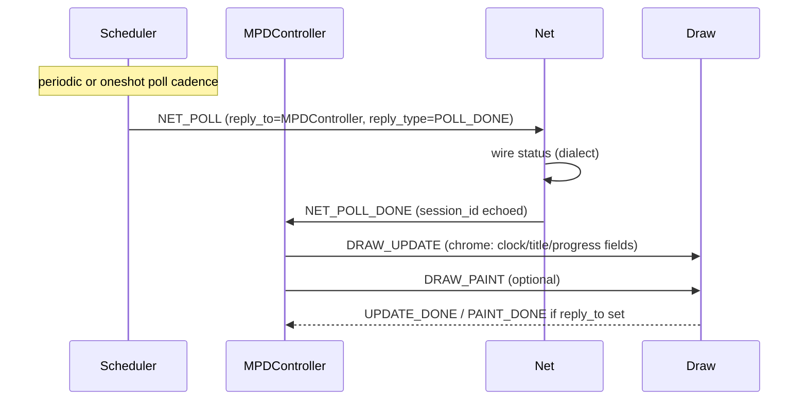
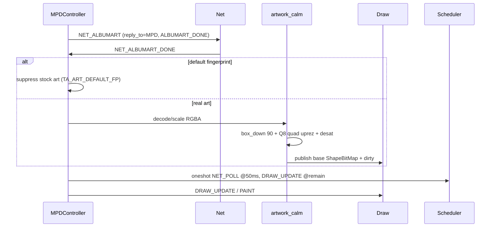
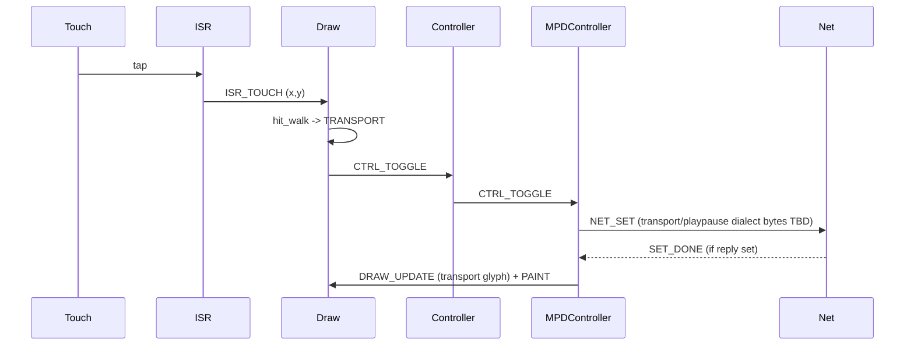
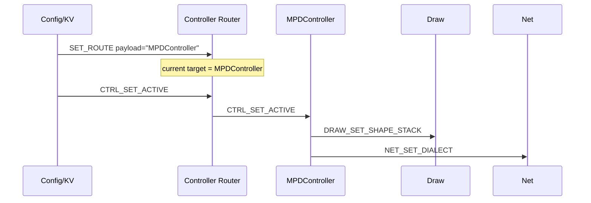

# spinme TaskActor exposition (as-built host)

Status: **as-built** for `spinme/host` C99 tests. Firmware still runs the
older follow/zlist path until these actors are ported. Directional plan:
[`PLAN.md`](PLAN.md). Host how-to: [`host/README.md`](host/README.md).

This document is the event and shape catalog: every registered TaskActor,
every event type and payload, how completion/"callback" works, every Shape
tag Draw knows, and the ISR touch/rotary decode path.

---

## 1. Event envelope (what every event looks like)

Defined in `host/ta_event.h`.

```c
#define TA_NAME_MAX 24
#define TA_PAYLOAD_MAX 32

typedef uint16_t ta_event_type_t;
typedef uint32_t ta_session_id_t;

typedef struct ta_event {
    ta_event_type_t type;
    char src[TA_NAME_MAX];
    ta_session_id_t session_id;
    /* Optional completion: empty reply_to means none. */
    char reply_to[TA_NAME_MAX];
    ta_event_type_t reply_type;
    uint16_t payload_len;
    uint8_t payload[TA_PAYLOAD_MAX];
} ta_event_t;
```

| Field | Role |
|-------|------|
| `type` | Discriminant; ranges owned by subsystems (see catalog below) |
| `src` | Producer actor name (NUL-terminated, max 23 chars + NUL) |
| `session_id` | Correlates a multi-step conversation; opaque u32 |
| `reply_to` | **Completion destination actor name**, or empty = no reply |
| `reply_type` | Type of the completion event to post to `reply_to` |
| `payload_len` / `payload` | Up to 32 raw bytes; layout is per-`type` |

Helpers: `ta_event_clear`, `ta_event_set_src`, `ta_event_set_reply`,
`ta_event_set_payload`, `ta_log_prefix`.

### Can an event carry a callback?

**Yes, but not a function pointer.** Completion is **actor-name + reply
event type**:

- Set with `ta_event_set_reply(ev, "SomeActor", SOME_DONE_TYPE)`.
- Handler, when finished, builds a new `ta_event_t` with
  `type = reply_type` (or a fixed DONE type -- see per-actor notes),
  copies `session_id`, sets `src` to itself, and
  `ta_registry_post(reply_to, &reply)`.
- Empty `reply_to[0] == '\0'` means **fire-and-forget** (no completion).
- Payload of the *request* is not automatically copied into the reply
  unless a handler chooses to; stub handlers usually send empty payloads.

**Special reuse -- Scheduler START:** `reply_to` / `reply_type` are the
**fire destination** and **fire event type** when the timer elapses (not a
"START done" ack). See Scheduler section.

There is **no** `void (*)(void*)` callback field on the envelope.

### Foundation types (`ta_event.h`)

| Type | Value | Meaning |
|------|-------|---------|
| `TA_EV_NOP` | 0 | No-op |
| `TA_EV_LOG` | 1 | Log line (Logger payload) |
| `TA_EV_SET_ROUTE` | 2 | Controller Router: set active controller name |

---

## 2. Plumbing (not TaskActors, but every post goes through them)

### Registry (`ta_registry`)

| API | Role |
|-----|------|
| `ta_registry_register(name, enqueue_fn)` | Bind actor name to enqueue |
| `ta_registry_lookup(name)` | Get fn or NULL |
| `ta_registry_post(name, ev)` | Lookup + call enqueue (mutex not held across handler) |

### Queue (`ta_queue`)

MP/SC host stand-in (pthread). Device maps to FreeRTOS queue.

| API | Role |
|-----|------|
| `ta_queue_push` | Producer; drop if full (`drops++`), never block forever on host tests |
| `ta_queue_peek_wait` / `try_peek` / `pop` | Consumer |

Separate `ta_shape_lock_*` for shape/pixel protocol (not the queue mutex).

### Init (`ta_init`)

Not event-driven. Ordered list of `ta_entry_fn` start hooks
(`ta_init_add_entry`, `ta_init_run_entries`). Actors typically
`register` themselves inside `*_start()`.

### Config / KV (`ta_kv`)

Not a TaskActor. NVM facade: string key -> length-known bytes, copy-out get.
Well-known key: `TA_KV_KEY_CONTROLLER` (`"current_controller"`).
Helpers: `ta_config_get_controller` / `ta_config_put_controller`.

---

## 3. TaskActors and event APIs

Registered names and ownership:

| Registry name | Constant | Source | Owns type range |
|---------------|----------|--------|-----------------|
| `Logger` | `TA_LOGGER_NAME` | `ta_logger` | uses `TA_EV_LOG` |
| `Draw` | `TA_DRAW_NAME` | `ta_draw_events` | `0x200..` |
| `Net` | `TA_NET_NAME` | `ta_net_events` | `0x300..` |
| `Controller` | `TA_CONTROLLER_NAME` | `ta_router` | `TA_EV_SET_ROUTE` + forwards ControlEvents |
| `MPDController` | `TA_MPD_NAME` | `ta_controller` | consumes ControlEvents |
| `SonosController` | `TA_SONOS_NAME` | `ta_controller` | stub, same surface |
| `Scheduler` | `TA_SCHED_NAME` | `ta_sched_events` | `0x500..` |

ISR mail is **not** a registry actor; it only accepts `0x100`/`0x101` into
Draw's ingress.

Helpers that are **not** actors: artwork (`ta_artwork_*`), hit walk
(`ta_react_*`), follow chrome builder, shape/text/viewport/under-image math.

---

### 3.1 Logger

**Start:** `ta_logger_start()` registers `Logger`.

| API | Role |
|-----|------|
| `ta_logger_enqueue` | Accept events |
| `ta_logger_emit(...)` | Build `TA_EV_LOG` and post |
| `ta_logger_set_policy` / `policy` | Per-severity: DROP / NVM / EXTERNAL |
| `ta_logger_drain` | Process queued logs |

**`TA_EV_LOG` payload:** `[severity u8][tag u8][text...]` (rest of 32-byte cap).

**Callback:** none required; emit is one-way unless a future policy adds ack.

---

### 3.2 Draw

**Start:** `ta_draw_start()`. Stub `ta_draw_handle` increments stats; real
paint/update live in `ta_draw_update` / `phase1` / `phase2` (called by
firmware/host glue, not fully wired inside the stub switch yet).

| Type | Value | Payload (today) | Completion |
|------|-------|-----------------|------------|
| `TA_EV_DRAW_UPDATE` | 0x200 | none in stub | if `reply_to` set -> `TA_EV_DRAW_UPDATE_DONE` (0x210) |
| `TA_EV_DRAW_PAINT` | 0x201 | none | -> `TA_EV_DRAW_PAINT_DONE` (0x211) |
| `TA_EV_DRAW_REACT_TOUCH` | 0x202 | intended: touch xy (see ISR); stub ignores | none |
| `TA_EV_DRAW_REACT_ROTATE` | 0x203 | intended: steps; stub ignores | none |
| `TA_EV_DRAW_SET_SHAPE_STACK` | 0x204 | Controller installs stack (TBD bytes) | none |
| `TA_EV_DRAW_LOG` | 0x205 | log divert | none |
| `TA_EV_DRAW_SCROLL_OX` | 0x206 | `ox` as i16 LE (2 bytes); from Scheduler scroll | none |
| `TA_EV_DRAW_UPDATE_DONE` | 0x210 | reply | n/a |
| `TA_EV_DRAW_PAINT_DONE` | 0x211 | reply | n/a |

Glass pipeline (called around UPDATE/PAINT, not separate event types):

1. **`ta_draw_update`** -- dirty Shape/UILayout flags only; may run
   `TA_UPD_REPRESENT_TIME` for clock digits. Never touches `*pixels`.
2. **`ta_under_after_update`** -- if base dirty, invalidate under-Cache;
   scroll/clock alone does not.
3. **`ta_draw_phase1`** -- farthest->nearest rebuild dirty local pixmaps;
   optional under-image under L2R.
4. **`ta_draw_phase2`** -- nearest->farthest coverage cull; emit exterior
   push list; clear dirty.

---

### 3.3 Net (+ MPD dialect)

**Start:** `ta_net_start()`. Immediate stub replies on enqueue.
**Dialect helper:** `ta_net_mpd_handle` / `ta_net_mpd_tick` coalesce volume
and defer POLL/ALBUMART completion until tick (host fake wire).

| Type | Value | Payload | Completion |
|------|-------|---------|------------|
| `TA_EV_NET_SET_DIALECT` | 0x300 | TBD (MPD vs Sonos) | none in stub |
| `TA_EV_NET_POLL` | 0x301 | none | `reply_to` -> `TA_EV_NET_POLL_DONE` (0x310) |
| `TA_EV_NET_SET` | 0x302 | volume: first byte desired level (coalesced in MPD dialect) | `TA_EV_NET_SET_DONE` (0x311) on stub Net; MPD dialect sends on tick after coalesce |
| `TA_EV_NET_ALBUMART` | 0x303 | TBD (uri/fp); stub none | `TA_EV_NET_ALBUMART_DONE` (0x312) |
| `TA_EV_NET_POLL_DONE` | 0x310 | reply (status blob TBD) | n/a |
| `TA_EV_NET_SET_DONE` | 0x311 | reply | n/a |
| `TA_EV_NET_ALBUMART_DONE` | 0x312 | reply (bytes/fp TBD) | n/a |

MPD dialect also no-ops unsupported `TA_EV_CTRL_NEXT` / `PREV` when seen on
the Net side.

**Artwork calm (not an event):** after decode to RGBA, product path is
`ta_artwork_calm_rgba`: box-down to `TA_ART_LORES` (90), Q8 quadratic
B-spline 2D uprez, light desat. Default-art fingerprint
`TA_ART_DEFAULT_FP`. Album change helper
`ta_artwork_on_album_change` arms Scheduler oneshots (NET_POLL @ 50 ms,
DRAW_UPDATE @ time-remaining).

---

### 3.4 Controller Router + Controllers

**Router** registers as `"Controller"`. Only it handles `TA_EV_SET_ROUTE`;
everything else is forwarded **intact** (including `reply_to` /
`reply_type` / `session_id` / `payload`) to the current target name.

| Type | Value | Payload | Notes |
|------|-------|---------|-------|
| `TA_EV_SET_ROUTE` | 2 | controller registry name bytes (no need for NUL; router adds it) | sets route; not forwarded |

**ControlEvents** (posted to `"Controller"`, consumed by MPD/Sonos):

| Type | Value | Payload | Completion |
|------|-------|---------|------------|
| `TA_EV_CTRL_TOGGLE` | 0x400 | none | optional: reply with same type to `reply_to` (stub) |
| `TA_EV_CTRL_VOLUME` | 0x401 | optional: `i8` steps in byte 0 (from rotate) | optional echo |
| `TA_EV_CTRL_NEXT` | 0x402 | none | none in stub |
| `TA_EV_CTRL_PREV` | 0x403 | none | none in stub |
| `TA_EV_CTRL_SET_ACTIVE` | 0x404 | none | posts `DRAW_SET_SHAPE_STACK` + `NET_SET_DIALECT`; optional echo |

Names: `MPDController`, `SonosController`.

---

### 3.5 Scheduler

**Start:** `ta_sched_start()`. Fake time: `ta_sched_advance_ms` /
`TA_EV_SCHED_TICK` payload.

| Type | Value | Payload | Meaning |
|------|-------|---------|---------|
| `TA_EV_SCHED_START` | 0x500 | `period_ms` u32 LE + `flags` u8 (`TA_SCHED_FLAG_ONESHOT=0x01`) | **`reply_to` = fire dst**, **`reply_type` = fire type** |
| `TA_EV_SCHED_STOP` | 0x501 | none | clear all slots |
| `TA_EV_SCHED_TICK` | 0x502 | `delta_ms` u32 LE | advance fake clock and fire due slots |

Convenience arms (post START):

| API | Fire type | Period |
|-----|-----------|--------|
| `ta_sched_arm_clock_1hz(dst, session)` | `TA_EV_DRAW_UPDATE` | 1000 ms periodic |
| `ta_sched_arm_scroll(dst, session, every_ms)` | `TA_EV_DRAW_SCROLL_OX` (+ i16 ox payload) | periodic |
| `ta_sched_arm_oneshot(dst, session, delay, fire_type)` | caller-chosen | one-shot |

Overdue policy: one fire, then `next = now + period` (no catch-up burst).
16 slots; oneshots preferred front of table.

---

### 3.6 ISR ingress (into Draw only)

Not a TaskActor. Types allowed on the FromISR path only:

| Type | Value | Payload |
|------|-------|---------|
| `TA_EV_ISR_TOUCH` | 0x100 | `x u16 LE`, `y u16 LE` (4 bytes) |
| `TA_EV_ISR_ROTARY` | 0x101 | `steps i8`, `velocity_q8 u8` (2 bytes) |

Any other type is **rejected** by `ta_isr_mail_push_from_isr` (no Wi-Fi,
paint, or Net from ISR). Capacity 8; full => drop + error log, never block.

---

## 4. Type range map (quick)

| Range | Owner |
|-------|-------|
| 0x000.. | Foundation (`NOP`, `LOG`, `SET_ROUTE`) |
| 0x100.. | ISR mail (`TOUCH`, `ROTARY`) |
| 0x200.. | Draw |
| 0x300.. | Net (+ DONE at 0x310..) |
| 0x400.. | ControlEvents (via Controller) |
| 0x500.. | Scheduler |

---

## 5. Shapes Draw supports

Shape table: `TA_SHAPE_MAX` 1024 (`idx10`). UILayout points at an idx; only
UILayouts are painted to glass.

### Tags (as-built)

| Tag | Value | Struct | Role |
|-----|-------|--------|------|
| `TA_SHAPE_TAG_BITMAP` | 1 | `ta_shape_bitmap_t` | Fixed pack66 pixmap (`w`,`h`,`*pixels`) |
| `TA_SHAPE_TAG_L2R` | 2 | `ta_shape_l2r_t` | Left-to-right composite: shapepack idxs + kernings -> bake |
| `TA_SHAPE_TAG_VIEWPORT` | 3 | `ta_shape_viewport_t` | Window over a child; `ox`/`oy` scroll; bake intersection |

No other tags exist in host code today. Under-image is a **BitMap** used as
under-Cache (policy in `ta_under_image`), not a separate tag.

### Shared header fields (conceptual)

`tag`, `dirty`, `w`, `h`, optional `*pixels` (pack66:
`R6 | G6<<8 | B6<<16 | A2<<24`; `A2==0` skip).

### ShapeL2R extras

- `pack`: zero-terminated shapepack words.
- Packing tags in top 2 bits of each word: `3x10` / `4x7` / `5x6` / `6x5`
  idxs (`TA_PACK_TAG_*`).
- `kernings`: signed per item; `TA_SHAPEPACK_END` (0) terminates stream.
- APIs: `ta_shapepack_encode` / `decode_word`, `ta_shape_l2r_compute_size`.

### Text is not a Shape

`ta_text_build` is a **constructor**: ASCII + glyph map (+ optional kern
table) -> fills a `ta_shape_l2r_t` (+ pack/kern buffers).

### Viewport

`ta_viewport_bake`: copy visible child intersection into viewport
`pixels` at `ox`/`oy`. Does not touch under-image shapes.

### UILayout (display list, not a Shape)

One 32-bit word: `dirty`, pad, `x`/`y` int10, `shape` idx10.
Parallel `accept_hit[]` (not packed into the word -- WorkItem 0006 choice).
Max `TA_UILAYOUT_MAX` 64.

### Follow chrome slots (product salvage layout)

| Slot | Index | Hit? | Dynamic high-z? |
|------|-------|------|-----------------|
| base | 0 | no | no (paint-once) |
| zone | 1 | no | no |
| artist | 2 | no | no |
| album | 3 | no | no |
| title | 4 | no | yes (scroll) |
| volume | 5 | **yes** | no |
| transport | 6 | **yes** | no |
| clock | 7 | no | yes |

Built by `ta_follow_chrome_build`.

---

## 6. Interrupts: touch and rotary -> events -> ControlEvents

### Capture (ISR context)

```
Hardware (CST816 touch / quadrature encoder)
        |
        |  ISR: no task mutex, no Net, no paint
        v
ta_isr_post_touch(mail, x, y)     or   ta_isr_post_rotary(mail, steps, vel_q8)
        |
        |  builds ta_event (src="ISR", type=ISR_TOUCH|ROTARY, payload as above)
        v
ta_isr_mail_push_from_isr(mail, &ev)   # ring of 8; drop if full
```

**Rotary decode helpers** (before post; typically in ISR or short critical
section):

| API | Role |
|-----|------|
| `ta_encoder_gray_step(prev_ab, cur_ab)` | 2-bit AB gray table -> -1 / 0 / +1 detent |
| `ta_encoder_velocity_steps(delta_us, max_step)` | map inter-detent time to step count (slow=1, flick up to max) |

Host packs already-decoded `steps` + `velocity_q8` into the event; the gray
filter is available for firmware GPIO samples.

### Drain (Draw task context)

```
ta_isr_mail_drain_to_queue(mail, draw_q)
        |
        v
Draw dequeues -> treat as REACT_TOUCH / REACT_ROTARY (or handle ISR types)
        |
        v
ta_react_touch(chrome, x, y, session, shape_w, shape_h)
   or ta_react_rotate(steps, session)
```

### Hit decode -> ControlEvents

`ta_hit_walk`: nearest-first over UILayouts with `accept_hit`; axis-aligned
box vs shape w/h. Roles: `TA_HIT_TRANSPORT` | `TA_HIT_VOLUME` | `NONE`.

| Input | Resulting event to `"Controller"` |
|-------|-----------------------------------|
| Touch on transport | `TA_EV_CTRL_TOGGLE` (no payload) |
| Touch on volume | `TA_EV_CTRL_VOLUME` (no payload in stub) |
| Touch miss | no post (return 1) |
| Rotate | `TA_EV_CTRL_VOLUME` with payload `[steps i8]` |

Router forwards to active `MPDController` / `SonosController`.

```mermaid
sequenceDiagram
  participant HW as Touch/Encoder HW
  participant ISR as ISR
  participant Mail as isr_mail
  participant Draw as Draw
  participant Hit as hit_dispatch
  participant R as Controller Router
  participant MPD as MPDController

  HW->>ISR: sample
  ISR->>ISR: gray_step / velocity (rotary)
  ISR->>Mail: ISR_TOUCH or ISR_ROTARY
  Note over Mail: FromISR only; drop if full
  Draw->>Mail: drain_to_queue
  Mail->>Draw: event
  Draw->>Hit: react_touch / react_rotate
  Hit->>R: CTRL_TOGGLE or CTRL_VOLUME
  R->>MPD: forward envelope
```

---

## 7. Normal product flows (sequence diagrams)

Host stubs complete many replies immediately; MPD dialect may defer until
`ta_net_mpd_tick`. Diagrams show the **intended** conversation shapes the
APIs already encode.

### 7.1 Playing MPD -- status poll / progress



Progress on glass: clock via `arm_clock_1hz` -> `DRAW_UPDATE` with
represent-time; title scroll via `arm_scroll` -> `DRAW_SCROLL_OX` (ox in
payload) then update/paint. Track-end anticipation:
`ta_artwork_on_album_change` / oneshot at time-remaining -> `NET_POLL` and
`DRAW_UPDATE`.

### 7.2 Album art change



### 7.3 Play / stop (transport toggle)



### 7.4 Volume (touch strip or rotary)

```mermaid
sequenceDiagram
  participant HW as Encoder/Touch
  participant ISR as ISR
  participant Draw as Draw
  participant R as Controller
  participant MPD as MPDController
  participant Net as Net

  alt rotary
    HW->>ISR: AB edges
    ISR->>ISR: gray_step + velocity_steps
    ISR->>Draw: ISR_ROTARY (steps, vel_q8)
    Draw->>R: CTRL_VOLUME payload[0]=steps
  else touch volume
    ISR->>Draw: ISR_TOUCH
    Draw->>R: CTRL_VOLUME
  end
  R->>MPD: CTRL_VOLUME
  MPD->>Net: NET_SET (volume byte; MPD dialect coalesces)
  Net-->>MPD: SET_DONE
  MPD->>Draw: DRAW_UPDATE (volume chrome)
```

### 7.5 Activate MPDController



---

## 8. File map (`spinme/host`)

| Area | Files |
|------|-------|
| Envelope / registry / queue / init | `ta_event.*`, `ta_registry.*`, `ta_queue.*`, `ta_init.*` |
| Logger / KV | `ta_logger.*`, `ta_kv.*` |
| Draw events + glass | `ta_draw_events.*`, `ta_draw_update.*`, `ta_draw_phase1.*`, `ta_draw_phase2.*`, `ta_under_image.*` |
| Shapes / layout / text | `ta_uilayout.*`, `ta_shape_l2r.*`, `ta_text.*`, `ta_viewport.*` |
| Follow / hit | `ta_follow_chrome.*`, `ta_hit_dispatch.*` |
| ISR | `ta_isr_mail.*`, `ta_input_isr.*` |
| Net / MPD / Controller | `ta_net_events.*`, `ta_net_mpd.*`, `ta_router.*`, `ta_controller.*` |
| Scheduler | `ta_sched_events.*` |
| Artwork | `ta_artwork.*` |

Run: `(cd spinme/host && make test)`.

---

## 9. Explicit non-goals / gaps (honest)

- Function-pointer callbacks on events: **not supported**; use `reply_to`.
- Full HTTP/MPD wire and TJpgDec: firmware / future Net body; host stubs.
- Draw stub does not yet call phase1/2 inside `ta_draw_handle`.
- SonosController is a surface stub.
- LVGL: out (`PLAN.md`).
- Gaussian calm path: removed; Q8 quadratic only.
