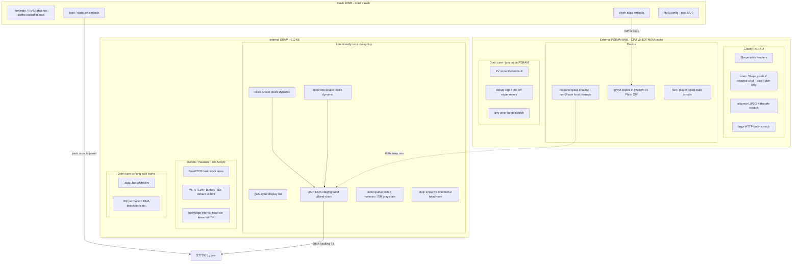

# spinme redesign (direction)

Status: **plan / direction**, not as-built. Firmware and `uimk2/` still
implement the old Core A/B + follow zlist path until this lands.

FreeRTOS is assumed. No core is special: work is owned by long-lived
**TaskActors**. Actors are **re-active**: they only advance by processing
**events** (from other actors, from Scheduler, from the screen / ISRs).

---

# Broad strokes

- TaskActors are re-active event processors. 1-1 actor-queue. Anyone posts
  typed ADT events to a looked-up `enqueueFn`.
- Screen (rotary/touch ISR) feeds **Draw** only; Draw posts **ControlEvents**
  toward the active **Controller**. Scheduler posts time/scroll/poll cadences
  as events. Controllers coordinate Draw shape stacks and Net wire dialects.
- Graphics: tree of **R6G6B6A2** (pack66) bitmaps. Shift/add alpha composite
  onto backing pixmaps. LVGL is out.
- **Display list and generation graph are separate** (see Layout vs Shapes
  below). Do not collapse them back into one "shape zlist that both builds
  and paints."

## Roadmap (phasing)

1. **MVP** -- re-active TaskActors (Init, registry, Draw, Net, Config,
   **Controller Router**, **MPDController**; SonosController stub OK),
   UILayout vs Shape, follow-style glass, MPD/Volumio dialect on Net,
   rotary/touch as today. Config exposes rudimentary **NVM KV**
   (string->bytes, copy-out); Flash-backed when ready, RAM/default until then.
2. **After MVP:** richer durable config (wifi, zone/host, …) still via the
   same KV/NVM facade -- grow keys and Config policy, not a second store.
3. **Deferred after that: different UI + input** -- wholesale swap to a
   point-and-rotate interaction model and a new screen layout. Do not design
   MVP shapes/events around that UI. Explicitly out of scope until config
   exists.

---

# Directional split: UILayout vs Shape (read this first)

This is the load-bearing change from the old design. Old uimk2/follow_glass
put **position, dirty, pixels, and update policy** on one zlist entry. That
conflation is rejected here.

## Two layers

| Layer | Name in this plan | Lives | Owns | Does not |
|-------|-------------------|-------|------|----------|
| **Display list** | `UILayout` (UI bitmaps / layout bitmaps) | SRAM array of plain structs | Panel placement `(x,y)`, z-order, dirty-vs-screen, index into a Shape | Generate pixels; L2R/Text policy; net state |
| **Generation graph** | `Shape` (tagged union) | Shape table (PSRAM-friendly) | How pixels are built: fixed bitmap, L2R pack, sizes, `*pixels` | Know where it sits on the glass; talk to QSPI |

```
  Shapes actor                     UI actor
  -----------                      --------
  Shape tree / table               []UILayout in SRAM (z-sorted)
       |  produces / refreshes            |
       |  Shape.pixels (pack66)           |  dirty => blit that rect
       +-------- idx10 -------------------+-----> panel (via staging band)
```

- **Only `UILayout` is drawn onto the screen.** Paint iterates the UILayout
  array (farthest first), and for each `dirty` entry sends that exterior to
  the display using pixels reached through `shapeidx`.
- **Shapes generate bitmaps.** A Shape is an abstract description (tag +
  fields). Updating a Shape may rebuild or invalidate its `*pixels`. It does
  not move on screen by itself; a UILayout points at it.
- **Text is not a Shape.** Text is a **constructor**: ascii + glyph map +
  kerning -> builds an L2R Shape (and its pack). Same idea may apply to other
  conveniences later.
- **Many UILayouts may share one Shape** (e.g. two placements of the same
  glyph atlas entry) or each UILayout may own a dedicated composite Shape.
  Indexing is by `idx10` into the shape table (1024 max).

### UILayout (display list entry)

Packs into one 32-bit word. All UILayouts are the same size, so they live as
an array of structs in **SRAM** (not pointers). Sorted in z-order.

```
type UILayout {           # one 32-bit word
  bool1 dirty;            # differs from what is on glass; needs paint
  bit1  _pad;
  int10 x, y;             # panel position (order TBD)
  idx10 shape;            # index into shape table -> pixels
}
```

```
SRAM []UILayout uilo;     # z-sorted; only these are screen-bound
```

On draw: phase 1 rebuilds dirty Shape local pixmaps (farthest first); phase 2
pushes whole dirty exteriors with top-down coverage culling (see Draw path).
Clearing `dirty` means that exterior's pixmap has been pushed to the glass.

### Shape (generation)

Shape structs are abstract descriptions (tagged union ~64-bit header +
payload). They are **not** the display list.

```
type ShapeABC {           # ~64 bit header sketch
  bit3  tag;
  bool1 dirty;            # pixels / children need rebuild
  bit8  _pad;
  int10 w, h;
  *pixels;                # R6G6B6A2 (pack66), or as tagged payload dictates
  // padding for union
}
```

#### ShapeBitMap

Fixed bitmap; adds no fields beyond ShapeABC. Glyph letters are ShapeBitMaps
with **zero padding** (tight ink box). Account for the letter atlas.

#### ShapeL2R

Assembles a list of shape indexes left-to-right into one bitmap. No higher
layout policy -- just packing.

A **shapepack** is a zero-terminated packing of shape indexes. Max 1024
shapes, so several idx pack into one word. Tag on the word selects packing
density: `11` / `10` / `01` / `00` for 3x10b, 4x7b, 5x6b, 6x5b. Put common
items (lowercase letters) in low indexes so 5-bit packing applies; rare
items and backgrounds in high indexes (e.g. 900s).

```
type ShapeL2R OF-UNION ShapeABC {
  *shapepack[] items;
  *int4[]      kernings;   # signed 4-bit spacing after item i
}
```

Resulting size: `w = sum(items.w) + kernings`, `h = max(items.h)`.

#### Text constructor (not a Shape)

Map ascii -> letter ShapeBitMaps, apply kerning table, emit an L2R Shape.
Callers that need "a string on glass" create Shape(s) via Text, then point a
UILayout at the result (or at a viewport/scroll wrapper once those exist).

### What this replaces from the old design

| Old (follow / uimk2 zlist) | New |
|---------------------------|-----|
| One zlist entry = position + update selector + px + hit | UILayout = position + dirty + shape idx; Shape = generation |
| `FOLLOW_*` exteriors sealed on the same struct as pixels | UILayout holds exterior; Shape holds w/h of pixels |
| Update SCROLL/CLOCKTEXT on the painted node | Scheduler/Shapes update Shape (or rebuild via Text); UILayout.dirty set when glass must change |
| Full-frame `curr`/`next` compare -> row bitmap | Prefer UILayout.dirty (shape exterior); see damage salvage below |
| `uimk2_bitmap` Layout/L2R/Viewport tree as paint path | L2R etc. are **Shape** generators; UILayout is the only paint path |

Host-test leftovers named LayoutBitMap / L2RBitMap in old `uimk2.txt` were an
earlier sketch of hierarchical bitmaps that both laid out **and** stored
screen data. That name collision is retired: **UILayout = screen list;
Shape = how pixels are made.**

---

# System

## Memory model (ESP32-S3)

PSRAM is **CPU-addressable with ordinary pointers**; the small hardware
EXTMEM cache fills on access (x86-like side effect). That cache is **not**
carved out of most of the 512 KB SRAM. Leftover internal SRAM is ordinary
internal heap / `.bss` / driver pools -- Wi-Fi and friends malloc or keep
permabuffers there. Peripherals **cannot DMA from PSRAM**; LCD staging must
be internal/`MALLOC_CAP_DMA`.

**Product constraint for this board:** only **clock** and **scrolling text**
need ongoing dynamic pixel buffers. Background and other decorations are
static: paint once onto the glass, then leave them (no resident recomposite).
Fixed dynamic outlines that sit over albumart (or other bases) use an
**under-Cache** (see Draw path) so a scroll/clock tick does not force a
full-stack recomposite of static chrome.

### Tentative layout (mermaid)



### Legend

| Bucket | Meaning | Examples |
|--------|---------|----------|
| **Intentionally SRAM** | We size and place these; keep the sum small | `[]UILayout`, clock pixels, scroll-line pixels, QSPI band, queue/ISR metadata, tiny slop |
| **Clearly PSRAM** | Large or cold; normal pointers OK | Shape headers, JPEG, HTTP scratch; static pixel maps *if* we keep them resident |
| **Decide** | Wrong call wastes SRAM or complicates paint | Panel-sized shadow FB yes/no; stack sizes; Wi-Fi RAM; glyphs Flash XIP vs PSRAM copy |
| **Don't care** | Policy = PSRAM (or IDF default); no design fight | **KV map**, debug blobs, misc scratch; most driver `.bss` |

Static chrome: prefer **Flash embed -> paint once -> not kept in the dynamic
set**. If a static ShapeBitMap stays in the table for hit-test or rare
redraw, its pixels are PSRAM/Flash -- not locked SRAM.

Full-frame RGB565 double buffer in SRAM (~518 KB) is rejected. Wire path
today remains RGB565 + byte-swap unless `panel_io` changes.

## NVM via KV (string -> length-known bytes)

Rudimentary **non-volatile** config needs a small interface now. A **KV store**
is the easiest surface: key = string, value = length-known bytes. The KV /
CRUD layer **owns the memory** for stored values (PSRAM cache + Flash NVS
backend as available). A coherent on-wire / in-event value layout matters
(length prefix + bytes); exact packing is an implementation detail as long as
every client uses the same codec.

### Access protocol (copy-out; no shared refcount)

**Rejected:** handing out interior pointers with a refcount (no update/delete
while readers > 0; no read while update pending). That is a deadlock /
priority-inversion maze across re-active actors.

**Adopted: caller-owned buffer, store copies out (and in).**

| Op | Contract |
|----|----------|
| `Has(key) -> bool` | Existence only. |
| `GetLen(key) -> len \| missing` | Size probe so caller can size a buffer. |
| `Get(key, dst, dst_cap) -> len \| missing \| too_small` | **Copy** value into `dst`. On `too_small`, `len` is the needed size; store unchanged. |
| `Put(key, src, len)` | **Copy** in; KV owns the new blob; replaces prior value atomically from the caller's view (no torn reads of the old pointer). |
| `Delete(key)` | Drop; memory reclaimed by KV. |

Cross-actor use: Config (or a thin Nvm actor owned by Config) is the only task
that touches the KV internals. Others send events (`Get` / `Put` / `Delete`)
and receive a **GetReply** whose payload is a **copy** (inline in the event if
small; otherwise a PSRAM block with **single-owner handoff** -- reply carries
the pointer, consumer frees or returns via `Recycle`, never a shared
refcount). Put/Delete run entirely inside Config's handler.

Sync helpers allowed only on the Config task itself (e.g. `InformCurrent`
reads `current_controller` via `Get` into a stack buffer).

---

# TaskActors (re-active)

## Actors only react to events

TaskActors are **re-active**. They do not poll the world in the abstract and
they do not "run the product loop." Each is a static, long-lived object with
a similar interface: block on its queue, **peek -> handle -> pop**, maybe
enqueue elsewhere, repeat.

**Events are the only cause of work.** Sources:

| Source | Examples |
|--------|----------|
| **Other actors** | Controller -> Net `SetVolume`; Net -> Controller status; Config -> Router `SetRoute` / routed `SetActive`; Controller -> Draw `SetShapeStack` |
| **Scheduler** | clock tick, scroll tick, poll cadence, screen-off one-shot -- each is an event posted to a named destination actor |
| **Screen** | rotary / touch ISR posts into **Draw** only; Draw turns hits/detents into **ControlEvents** toward the well-known **Controller** name (a Router) |

No actor reaches into another's private state. Cross-actor contact is **post an
event** to a cached `enqueueFn`.

## Scheduling: naive 1:1 with FreeRTOS (start here)

**MVP mapping: one TaskActor == one FreeRTOS task.** Each task blocks waiting
for its event queue to become non-empty (semaphore / task notify), then
peek -> handle -> pop. FreeRTOS does the preemption and core placement.

An n:m “goroutine” executor (many actors round-robin on few workers) stays a
possible later optimization if stack SRAM proves painful. **Do not build that
first.** With the planned cast size, 1:1 is not expected to be expensive;
measure stacks before inventing a userspace scheduler. Blocking Net work on
its own task remains correct under 1:1 without stalling Draw.

If 1:1 does hurt (task create fail, stack overflow, heap starvation), see
contingency CASE
[`cases/2026-11-01-spinme-taskactor-1to1-stacks.md`](../cases/2026-11-01-spinme-taskactor-1to1-stacks.md)
(status open): measure, trim stacks, then hybrid Draw/Net tasks + shared
executor for pure routers/controllers.

## Testing strategy (off-device first)

**All of the redesign is tested off-device before treating the board as the
oracle.** On-device smoke is last (flash + follow chrome), not the place where
actor graphs or pack66 math are debugged.

| Layer | What | Reuse / notes |
|-------|------|----------------|
| **Unit -- events / TaskActors** | Enqueue, peek/handle/pop, Router `SetRoute` + forward, registry register/lookup, ControlEvents ADT round-trip | New host harness; pattern from `uimk2/test_event.c` / host ring discipline |
| **Unit -- UILayout / Shape / Draw** | UILayout word, BitMap/L2R/Text/Viewport, update enums (no pixmap change), phase1 local pixmaps, phase2 coverage list, hit-test enum dispatch | Extend or replace `uimk2/test_bitmap.c`, `test_zlist.c`, host end-test WorkItem; do not keep testing the old zlist as the contract |
| **Unit -- graphics decode / calm** | TJpgDec NN path, default-art reject, RGBA calm post-filter, pack66 publish | `uimk2/bench_jpeg_dc.py`, ROM JPEG helpers; filter tests as host C or Python |
| **Unit -- Net / MPD dialect** | Non-blocking poll state machine, ControlEvents -> wire, coalesce volume, albumart GET handoff | Salvage `player_http` test seams / host stubs; fake socket or recorded bodies |
| **Large -- designed networks** | Multi-actor scripts: Init/registry, Config.InformCurrent -> Router.SetRoute -> SetActive -> Draw stack + Net dialect; album-change -> proactive poll; clock/scroll Scheduler -> Draw | Spirit of `uimk2/test_integ.c` / `integ_script` -- event scripts across the new cast, not Core A/B |
| **KV / NVM** | Get/Put/Delete copy-out protocol, too_small, Has/GetLen | Host fake Flash or RAM backend behind Config |

Board (`pio` upload/monitor) confirms integration only after the off-device
suite is green. Prefer one host `make test` (or successor) that runs the fast
suite without hardware.

### Emulator tier (ESP32-S3 on Mac M1+)

Between pure host unit tests and the knob board, an **emulator** can run the
real Xtensa firmware image without flashing.

| Option | Fit | Caveats |
|--------|-----|---------|
| **Espressif QEMU** (`idf.py qemu monitor`) | Official S3 path; dual-core Xtensa; UART; flash; **PSRAM** (quad/octal); timers; crypto; virtual RGB FB; OpenCores Ethernet for IP | **No Wi-Fi / BT / USB / I2C / SPI / RMT**. Prebuilt **aarch64-apple-darwin** via `idf_tools.py install qemu-xtensa`. Docs: IDF "QEMU Emulator" for esp32s3. |
| **espressif/esp-emulator** (beta) | Newer; S3 + claims Wi-Fi/BLE; Apple Silicon install script | Beta; evaluate before betting CI on it. |
| **IDF `linux` host target** | Native host speed (often >> realtime); FreeRTOS POSIX sim on macOS | Mocks hardware; not the Xtensa binary -- complements QEMU, does not replace it. |

**Faster than realtime:** plausible on M1+ for CPU-bound paths -- host is far
stronger than a 240 MHz S3, and QEMU need not run wall-clock locked. Treat
emulator time as **not** a substitute for real QSPI/Wi-Fi latency; use it for
TaskActor graphs, crashes, and logic under FreeRTOS on the real ISA. Knob
panel/touch/rotary still need the board (or heavy stubs).

**spinme stance:** keep **host C tests** as the fast default; add QEMU (or
esp-emulator if Wi-Fi-in-emu matters) as a middle CI/dev tier when the
firmware tree is IDF-friendly enough for `idf.py qemu`. Do not block MVP
design on emulator bring-up.

## Events as ADTs (async only)

Events are algebraic data types with a shared envelope. Prefer the lightest
on-device encoding that stays structured (packed tagged structs; nanopb only
if it pays for itself).

**No synchronous responses.** `A` never blocks waiting for `B`'s return value.
A request/reply is two disconnected events. To continue work after a reply,
either `A` keeps local session state or the reply carries enough context.

### Envelope fields (foundation)

| Field | Role |
|-------|------|
| `tag` / type | Event kind (ADT discriminant) |
| `src` | Sending actor name |
| `session_id` | Links all events in one logical action across actors (call-stack substitute) |
| `reply_to` (optional) | Callback: **name** of TaskActor to notify on completion |
| `reply_type` (optional) | Event type to send to `reply_to` when done |
| payload | Type-specific `oneof` |

**Logging prefix for every message:** `time`, `session_id`, `actor_name`.

**ControlEvents** are the shared control language every Controller backend
understands (`PollStatus`, `SetVolume`, `SetPlayPause`, ...). Some actors also
accept narrower private tags. Net accepts the same ControlEvents at its API
edge; wire bytes depend on the active dialect (some ops **noop**).

### Logger TaskActor

A dedicated **Logger** actor aggregates log lines (prefixed as above). Policy
per class of message: write to **NVM** sometimes, dump to an **external log
receiver** sometimes, **drop** other times. Other actors enqueue log events;
they do not open NVM or sockets for logging themselves.

### Build order implication

Stabilize **foundation** first (queue, registry, envelope+session, Router,
Logger, host harness). Then derive each actor's event interface in isolation.
After APIs are stable, actors may be worked **in parallel**; a `userneeded` in
one flow must not block all others.

## Resource ownership (still wins for glass / NIC)

**One glass -> one Draw actor. One NIC / socket plane -> one Net actor.**
Do not create `SonosDraw` / `MPDDraw` / `SonosNet` / `MPDNet` TaskActors.
Exclusive hardware stays on those singletons.

**No TaskActor subclass tree for backends either.** Backend choice is not
inheritance and not "fat Draw/Net with internal personality switches" as the
primary mechanism. Use a **Router** (below) to select among N peer actors.

## Router TaskActor (switchable; select-N)

A **generic Router** TaskActor processes **almost no events natively**. It
**routes** inbound events to a current target `enqueueFn`.

| Capability | Use |
|------------|-----|
| **Select among N alternatives** | **This product.** Well-known facade (e.g. `Controller`) is a Router; targets are `MPDController`, `SonosController`, ... |
| **Compose TaskActors** | Same primitive can fan or pipeline; not the spinme MVP pattern. |

**Only self-handled event:** change the routing target (`SetRoute` /
`SetTarget` -- name TBD). Everything else is forwarded unchanged to the
current target. No ControlEvent semantics inside the Router.

Peers (Draw, Scheduler, Net replies) address the **stable facade name**
registered by the Router. They do not cache the backend Controller's
`enqueueFn` for control traffic. Config (or whoever owns policy) posts
`SetRoute` when NVM says MPD vs Sonos; then posts activation work **through**
the Router (e.g. `SetActive`) so it lands on the new target.

## Name registry (one non-actory mutex)

Global `name -> enqueueFn`. `Draw` and `Net` stay bound to hardware owners.
The facade `Controller` binds to the **Router** once (not rebound per backend).
Backend Controllers also register under their own names for Init and for
`SetRoute` resolution.

- Each actor's **first** act on startup: insert its `enqueueFn` under its
  well-known name. **This is the one explicitly mutexed, non-actory
  operation** on the registry.
- Peers know counterpart **names** at compile time; they resolve
  `enqueueFn` from the table (retry/patient if Init race -- name not there
  yet). Do not hold the registry mutex across event handlers.

## Init and device bring-up

**Init** is a globally known TaskActor and the process that starts. It is
reusable across projects: it owns an **entry-point list** of actors to start.
Spinme-specific policy lives in **Controllers**, **Router**, and **Config**,
not in Init's core.

```
boot
  -> Init starts every entry in the list
       (Draw, Net, Config, ControllerRouter, MPDController, SonosController, ...)
  -> each actor registers name -> enqueueFn
  -> Init -> Config.InformCurrent
       -> NVS (or build default): current control kind = MPD
       -> ControllerRouter.SetRoute(MPDController)
       -> ControllerRouter <- SetActive   # forwarded to MPDController
            -> Draw.SetShapeStack (MPD follow chrome)
            -> Net.SetupControl (MPD dialect)
```

Upstream ControlEvents always go to `Controller` (Router) -> current backend.
Draw and Net registry bindings never move.

## Controllers (backend peers behind the Router)

Not one "Player" blob and not "Net owns the product." **N Controller
TaskActors**, one per control kind, as **route targets** -- not subclasses of
Draw/Net. Name suffixes mark the protocol / product face. All speak
**ControlEvents**; each coordinates its own logic and, when active, configures
the shared Draw/Net singletons.

| Actor | MVP |
|-------|-----|
| `Controller` (Router) | Generic select-N router; `SetRoute` only native handler |
| `MPDController` | Implement (Volumio / MPD face); route target |
| `SonosController` | Organize in the tree; stub OK; route target |

Organization matters even while only MPD is live.

## Queue locking (be precise)

Each actor queue is **multi-producer, single-consumer**.

| Who | Rule |
|-----|------|
| Consumer (the actor task) | Only task that peeks / processes / pops. Waits on a **semaphore** (or task notify) producers give after push. |
| Producers (other tasks) | Queue **mutex** only for: write tail slot, advance tail, give semaphore. Release before waiting elsewhere. |
| ISR producers (touch / rotary) | No task mutex. `FromISR` into **Draw** only; Draw enqueues ControlEvents to the **Controller Router** as a normal producer. |
| Full queue | Log ERROR; drop (prefer missable/idempotent events). Never block in ISR. |

**Peek then process then pop:** consumer owns the head for the whole handler.
Producers never mutate head. Mutex does not cover the handler body.

**Separate from queue locks:** Shape table / local pixmaps need their own
reader/writer protocol so Draw compose/push does not race definition updates.
Do not hold the shape lock across QSPI TX if TX can stall; snapshot band or
pointers under a short critical section.

## Static TaskActors (cast)

### Init

Starts the entry-point list; triggers `Config.InformCurrent` once the registry
has the names Init needs. Not spinme-product logic beyond "start these."

### Config

Owns the **NVM KV** facade (string -> length-known bytes; see NVM via KV).
Handles `InformCurrent` / switch: `Get` current control kind (build default if
missing), posts `ControllerRouter.SetRoute(<backend>)`, then `SetActive`
(through the Router so the new backend receives it). Other actors do not open
NVS themselves -- they event Config for Get/Put/Delete.

### Scheduler

Re-active timer source: soft timers (`last_run` + `every` ms) that **post
events** to destination actors (clock, scroll, poll, screen-off). Never opens
sockets. Permanent vs one-off lists; one-offs front-packed; overdue slot pushes
**one** event.

### Draw (screen + glass)

Owns: ISR decode edge, `[]UILayout`, shape pixels / local pixmaps, panel push,
hit-test. Reacts to Scheduler (update/draw cadences), Controllers
(`SetShapeStack`), Net/Controller completions that dirty glass, and screen
events.

Events (sketch):

- `update` -- update-enum walk; Shape **definitions** + dirty only; **no
  pixmaps**.
- `draw` -- phase1 local pixmaps farthest->nearest; phase2 coverage QSPI
  (see Draw path).
- `react_touch` / `react_rotate` -- box + `accept_hit`; **enum** dispatch
  switch (no fn ptrs); case returns true (handled) or false (try next lower;
  opacity may live here later). Enqueue **ControlEvents** to facade
  **Controller** (Router), not Net and not a backend name.
- `SetShapeStack` -- install the active Controller's follow (or other) layout.

### Net

Owns: sockets, NTP, and **dialect I/O** configured by the active Controller
backend. Understands ControlEvents at the actor edge; maps them to MPD vs
Sonos (etc.) wire messages; noops where the dialect cannot honor an op.
Salvage `player_http`: non-blocking tick; no `hostByName` on the hot path
after boot; coalesce in-flight (latest volume wins); albumart GET then hand
JPEG toward Draw without stalling glass. Completions are events back toward
the Controller facade / Draw -- not calls into another actor's guts.

### Controller Router

Generic select-N Router registered as `Controller`. Native: `SetRoute` only.
Forwards all other events to the current backend Controller.

### MPDController / SonosController / ...

Route targets. On routed `SetActive`: arm Draw stack + Net dialect. Coordinate
poll/set/artwork policy for that face. Implement **MPDController** for MVP;
keep SonosController as a sibling shell.

---

# Interrupts

FreeRTOS + ESP-IDF GPIO ISRs. Rotary: velocity-sensitive decode (salvaged
from `ROTARY.md`).

- Gray-code state matrix debounce (4-bit transition filter).
- Delta-t between detents scales step (slow = 1, flick up to MAX_STEP).
- ISR body in IRAM; post to UI via `FromISR` notify/queue only.
- Touch: same rule -- ISR posts press `(x,y)` to UI; UI hit-tests.

Draw then enqueues **ControlEvents** to the active Controller. Do not call
Wi-Fi or paint from the ISR.

---

# Draw path (pack66)

Graphics remain R6G6B6A2 composited bitmaps. A2==0 skip / RLE ideas and PIE
for opaque spans stay available (old blit path). Shape `*pixels` are pack66
(or rebuilt into pack66 before publish to UI).

**Recommendation:** `update` and `draw` stay distinct events (draw may run
immediately after update in one actor turn). Do **not** fold pixmap work into
`update` -- after update, **no pixmaps have changed yet**.

```
Draw.update:                         # defs only
  for each struct:
    dispatch update_enum  # noop | represent-time | ...
    # may set Shape.dirty; lower dirty dirties higher (static shadow)

Draw.draw:
  # Phase 1 -- compose local pixmaps (farthest -> nearest)
  for each shape farthest to nearest:
    if !shape.dirty: continue
    rebuild shape.local_pixmap from definition
      # upper pixmaps may src-over include already-built lower pixmaps
  # After phase 1: any (x,y) has exact color = topmost shape containing it.
  # We push rectangles, not a per-pixel walk.

  # Phase 2 -- paintable rects -> QSPI (nearest -> farther)
  # Rules: only dirty shapes; each rect == one whole shape exterior
  # (never cut a shape); pixels may be painted more than once; if a lower
  # shape is completely covered by a higher already-listed rect, omit it
  # (and do not visit shapes contained under that full cover).
  covered = []           # list of rects already queued for panel
  for each shape nearest to farthest:
    if shape fully inside union(covered):
      skip this shape and do not visit its contained lowers
      continue
    if !shape.dirty: continue
    push_rect(shape.exterior, shape.local_pixmap)  # via SRAM band
    covered.append(shape.exterior)
    clear shape.dirty (and matching UILayout.dirty)
```

Bezel clip remains a push-time concern (round glass). No panel-sized glass
shadow required for this model: coherence lives in **per-Shape local
pixmaps** plus the coverage list for QSPI.

### Damage / dirty salvage (shape exteriors)

Old idea: full `curr`/`next` memcmp -> row bitmap. New primary signal:
**Shape.dirty** (and UILayout.dirty when glass must change), set by update
enums and upward static-shadow propagation. Layouts are sealed; motion is
scroll via Shape rebuild or ox on a Viewport Shape.

Damage to the panel is whole shape exteriors (axis-aligned), possibly
overlapping. Measured earlier: narrow chrome saves QSPI; full-width SCROLL
does not -- coverage culling helps when an opaque higher L2R (or other)
fully covers a dirty lower.

Albumart / base: one shape/UILayout covering the panel (or round bounds),
dirty when decode completes; phase 1 rebuilds its local pixmap; phase 2
pushes it unless a higher dirty fully covers it (unusual for full-bleed).

### Update enums vs dirty (Draw `update`)

Draw's `update` event walks each struct and calls its **update** function
(enum dispatch). Most entries are `noop`. Example: clock is
`represent-time`: rewrite the Shape definition so an L2R (enforced; may be
built via Text) uses the glyph Shape idxs for the current HH:MM:SS -- six
glyphs + separators should pack as shapepack words (e.g. two words of
4x7-bit + tag). That step **only** updates the Shape definition (constituent
idxs / fields) and sets **`Shape.dirty`**. It does not blit and does not
walk the glass.

Outlines are sealed (no moving exteriors in the follow layout). Therefore
the "who is in shadow of whom" graph is **static**: for each Shape/UILayout,
the set of z+ covers is known at layout build time. Propagation rule: a
**lower dirty Shape dirties higher** Shapes in that shadow set (naive = all
z+; less naive = intersecting exteriors only -- see Cache below). Pixel
rebuild of generators/Caches happens because of `Shape.dirty`, not because
`update` painted.

UILayout.dirty (glass must change) tracks that an exterior must appear in
the phase-2 rect list until pushed. Ownership model: update + static shadow
edges + lower-dirties-higher; draw phase 1 fills local pixmaps; phase 2
pushes whole dirty exteriors with coverage culling.

### Cache / under-image and invalidation

Static chrome paint-once leaves a hole when a **fixed** outline (e.g. title
viewport box) sits over a changing base (albumart): the glass still needs
what was under that outline without redoing the whole stack every scroll
tick. Prefer an explicit **Cache** Shape (or tagged under-image) whose
exterior is sealed; rebuild = composite everything under that exterior,
then blit the dynamic viewport on top.

**Invalidation (all objects, especially Cache):** when an object is dirty,
propagate **upward** (toward the viewer, z+) along the static shadow graph:

| Policy | Rule |
|--------|------|
| Naive | Invalidate anything at z+ (everything stacked above the dirty object). |
| Less naive | Invalidate only z+ objects whose exterior **intersects** the damage. |

Rebuild invalidated under-caches **farthest first** so a higher Cache
composites fresh lower results. Scroll of a viewport that does not move its
Cache box does not invalidate that under-image; albumart/base updates do.

**Layout habit:** z-order strongly correlates with update frequency -- put
high-cadence layers (clock, scroll) on top. A clock *under* scrolling text
(or under any under-Cache) is pessimal: every tick forces z+ invalidation
into the layer above. That stack is allowed but not the intended product
ordering.

### Albumart / artwork (reuse MPD path; calm base)

**Reuse** the main MPD / Volumio artwork path that already works
(`player_http` albumart GET + ROM TJpgDec NN into the base): GET into PSRAM,
decode (clear black, coarsest scale with out >= panel, MCU ceil so no black
grid, pack66 A=255), mark base dirty, enqueue Draw. Do not invent a second
fetch/decode stack for Controllers -- MPDController + Net dialect call that
logic.

**Default / busy stock art:** recognize the player's default artwork (overly
busy Volumio/MPD placeholder) and **disable** it -- keep boot/static calm art
or solid/understated base instead of painting the stock image.

**Album change -> proactive poll:** when album (or effective artwork identity)
changes, fire an event so Net/Controller poll more eagerly. Use
**time-remaining** on the current track and Scheduler one-shots to approximate
track end (pre-arm the next status/artwork poll near boundaries), not only
slow periodic poll.

**Calm filter (before or as pack to base):** after decode (RGBA edge OK), apply
a calming pass before the base local pixmap is published -- **blur**,
**desaturation**, and **de-chroma** (reduce colorfulness so chrome/text stay
readable). Tunable; exact kernels TBD.

**Not free via JPEG:** selectively ignoring high DCT frequencies is **not** a
Gaussian and is not a stock TJpgDec knob -- that would mean patching/replacing
IDCT. Keep **coarse decode scale** for size (already required for NN fit). Do
calm as a **post-filter** on the RGBA edge (e.g. box or downsample-blur plus
desat/de-chroma), then pack66. Filtered result is what under-Caches composite
against.

### Follow chrome (product salvage; mapping TBD)

Old glass picture still desired as product:

- transport play/stop (hit target)
- clock HH:MM:SS
- zone / artist / album / title (title scrolls when wider than viewport)
- volume + desired overlay
- base albumart / boot art

Implementation mapping under the new split: Text/L2R Shapes for strings;
UILayouts for placement; Scheduler cadences for clock and scroll rebuilds;
Net for Volumio. Exact Shape graph is part of the rehash, not frozen here.

---

# Color formats (do not conflate)

| Stage | Format |
|-------|--------|
| Shape pixels (target) | pack66 R6G6B6A2 |
| Glyph source / JPEG decode | may still enter as RGBA8888 then pack |
| QSPI to ST77916 (current driver) | RGB565 + byte-swap |
| Panel IC marketing | RGB666 262K |

---

# Maybe deprecated / demoted

| Item | Note |
|------|------|
| Core A / Core B split as *the* architecture | Replaced by TaskActors; cores are just where tasks are pinned if useful |
| Single uimk2 zlist shape = paint + update | Replaced by UILayout vs Shape |
| Full-frame curr/next + row dirty as primary | Demoted; UILayout.dirty first |
| KV store | Promoted: rudimentary NVM API (string->bytes); Config-owned; copy-out protocol |
| `uimk2_follow` / `uimk2_sched` already deleted | Stay deleted; Scheduler + Shapes + UI absorb roles |
| LVGL | Still out |
| Function-pointer dispatch | Still out; enums + switches |
| Old docs: DESIGN.md, JOHANDESIGN.md, PRINCIPLES.md, ROTARY.md, uimk2.txt | Superseded by this PLAN; removed from tree |

Hardware notes under `hardware/` and board READMEs stay. Bench notes under
`uimk2/BENCH.md` stay until the blit library is retired or rewritten.

---

# Open questions (status)

All listed items answered (Q4 removed as non-question). Wrong-answer-awkward
forks (Q1--Q3) decided deliberately; Q5--Q8 ratified in order with the human.

### 1. Panel glass shadow vs local pixmaps? -- ANSWERED

**Answer:** No panel-sized glass shadow. After `update` (defs + dirty only),
`draw` phase 1 composes **local pixmaps** farthest -> nearest (upper may
include lower). Phase 2 selects whole dirty shape rects nearest -> farther,
may overpaint, omits lowers fully covered by the covered-rect list (and does
not visit contained shapes under a full cover). Point sampling equivalence:
topmost shape containing (x,y); panel path uses rectangles, not a pixel walk.

### 2. Who marks dirty? -- ANSWERED

**Answer:** Draw `update` enum mutates Shape definition + `Shape.dirty`.
Static shadow edges: lower dirty dirties higher. UILayout.dirty follows when
glass must change (after pixels ready / same upward pass). Not a
Shapes-walks-layouts vs reverse-multimap fork.

### 3. Scroll geometry? -- ANSWERED

**Answer:** **Viewport Shape**. A Viewport selects the **intersection** of its
window with the underlying child Shape (visible rect = viewport exterior ∩
child). Scroll is ox/oy (or equivalent) on the Viewport so the UILayout word
stays 32-bit -- not rebuild-L2R-each-tick as the primary model, and not ox on
UILayout. Title scrolls when wider than its viewport; zone/artist/album do
not. A scroll tick must not invalidate a sealed under-image whose box did not
move.

### 4. (removed -- not a design question)

Core affinity for TaskActors is not a product/API fork. FreeRTOS places tasks;
pin or migrate later if measurement says so. No PLAN decision to record.

### 5. Player vs Net vs Controllers? -- ANSWERED

**Answer:** **Controllers behind a Router.** N backend Controller TaskActors
(`MPDController`, `SonosController`, ...); shared **ControlEvents**; name
suffix marks protocol/face. A generic **Router** (facade name `Controller`)
selects among them -- it handles only `SetRoute`; all other events forward.
**No** backend subclasses of Draw/Net. **One Draw, one Net** (resource
ownership); the active Controller configures those singletons. Implement
MPDController for MVP; stub SonosController. Actors are re-active.

### 6. KV store now or later? -- ANSWERED

**Answer:** **Now**, as the rudimentary **NVM interface**: string key ->
length-known bytes; KV CRUD owns stored memory. Access protocol is
**copy-out Get** / **copy-in Put** (optional `GetLen`); cross-actor replies
use copies or single-owner handoff -- **not** shared refcounted interior
pointers (deadlock hazard). Config owns the facade.

### 7. Pack66 vs RGBA in Shape.pixels? -- ANSWERED

**Answer:** **A -- publish pack66 (R6G6B6A2) only.** Glyphs/JPEG may enter as
RGBA at the edge; anything in Shape local pixmaps / Draw compose / publish
path is pack66. No permanent RGBA panel-sized buffers.

### 8. Hit-test box vs opacity sample? -- ANSWERED

**Answer:** **C -- box + `accept_hit` now; opacity optional inside the
handler.** Hit-test finds UILayouts top-most first whose exterior contains
`(x,y)` and `accept_hit` is set. There are **no function-pointer callbacks**:
an **enum** selects a case in a shared dispatch function (`switch` /
`case`). That case **handles and returns true** (MVP: always true for the
transport/fat box) or **declines and returns false** (later: e.g. opacity
sample on pack66 A2). On false, hit-test continues to the next lower
`accept_hit` candidate. On true, enqueue the ControlEvent / side effect and
stop.

---

# Salvage index (where old ideas went)

| Source | Landed in |
|--------|-----------|
| DESIGN.md memory / 565 vs 666 / albumart NN / follow chrome | Memory pools; Color; Albumart; Follow chrome |
| PRINCIPLES.md exterior damage | Damage / dirty salvage; Open Q1 |
| Session: under-Cache + z+/intersect invalidation; z vs update freq | Cache / under-image and invalidation |
| Session: update enums; Shape.dirty; static shadow; lower dirties higher | Update enums vs dirty; Open Q2 answered |
| Session: reframed glass-shadow complaint | Open Q1 (then answered) |
| Session: draw = local pixmaps + coverage rect push | Draw path; Open Q1 answered |
| JOHANDESIGN.md ring peek/handle/pop; scheduler pushes events | Queue locking; Scheduler |
| Session: re-active actors; Init/registry; Controllers; ControlEvents | TaskActors (re-active) |
| ROTARY.md velocity ISR | Interrupts |
| uimk2.txt L2R / idx packing / letter atlas | ShapeL2R; ShapeBitMap letters |
| Old Core A push band | Still the QSPI staging approach under UI paint |
