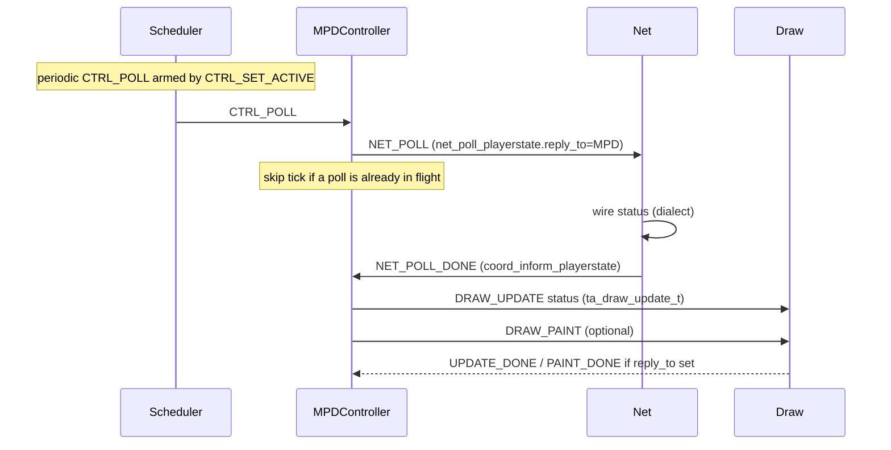
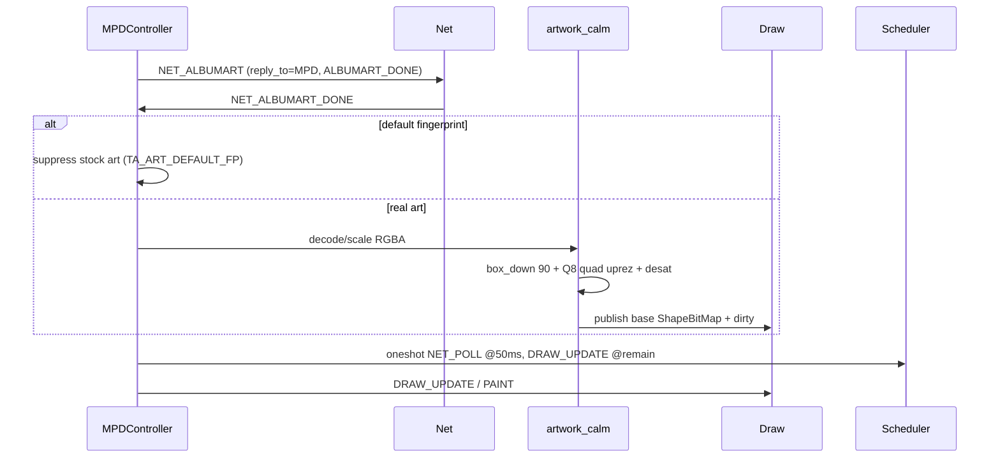
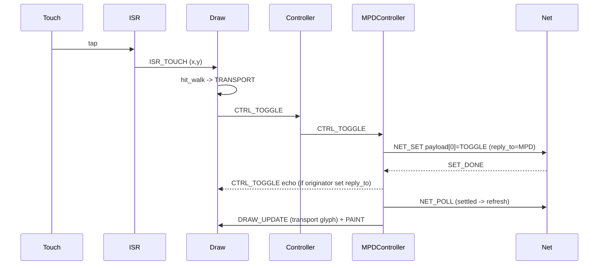
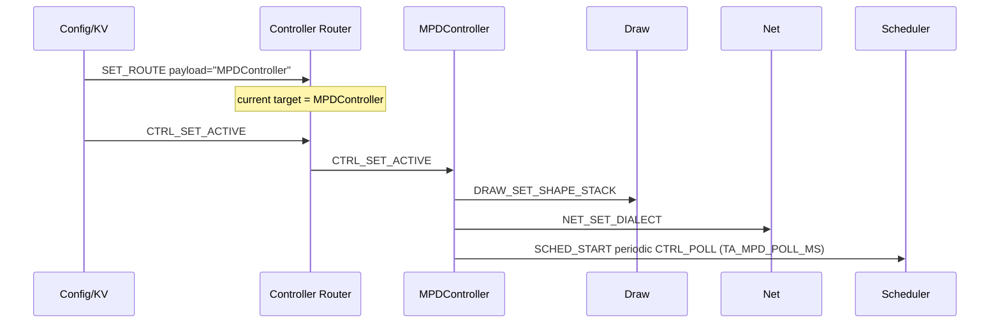

# ISR path and product flows

### Capture (ISR context)

```
Hardware (CST816 touch / quadrature encoder)
        |
        |  ISR: no task mutex, no Net, no paint
        v
ta_isr_post_touch(mail, x, y)     or   ta_isr_post_rotary(mail, steps, vel_q8)
        |
        |  builds ta_event (src="ISR", type=ISR_TOUCH|ROTARY, payload as above)
        v
ta_isr_mail_push_from_isr(mail, &ev)   # ring of 8; drop if full
```

**Rotary decode helpers** (before post; typically in ISR or short critical
section):

| API | Role |
|-----|------|
| `ta_encoder_gray_step(prev_ab, cur_ab)` | 2-bit AB gray table -> -1 / 0 / +1 detent |
| `ta_encoder_velocity_steps(delta_us, max_step)` | map inter-detent time to step count (slow=1, flick up to max) |

Host packs already-decoded `steps` + `velocity_q8` into the event; the gray
filter is available for firmware GPIO samples.

### Drain (Draw task context)

```
ta_isr_mail_drain_to_queue(mail, draw_q)
        |
        v
Draw dequeues -> treat as REACT_TOUCH / REACT_ROTARY (or handle ISR types)
        |
        v
ta_react_touch(chrome, x, y, session, shape_w, shape_h)
   or ta_react_rotate(steps, session)
```

### Hit decode -> ControlEvents

`ta_hit_walk`: nearest-first over UILayouts with `accept_hit`; axis-aligned
box vs shape w/h. Roles: `TA_HIT_TRANSPORT` | `TA_HIT_VOLUME` | `NONE`.

| Input | Resulting event to `"Controller"` |
|-------|-----------------------------------|
| Touch on transport | `TA_EV_CTRL_TOGGLE` |
| Touch on volume | `TA_EV_CTRL_VOLUME` mode NONE |
| Touch miss | no post (return 1) |
| Rotate | `TA_EV_CTRL_VOLUME` mode REL + `delta` |

Router forwards to active `MPDController` / `SonosController`.

```mermaid
sequenceDiagram
  participant HW as Touch/Encoder HW
  participant ISR as ISR
  participant Mail as isr_mail
  participant Draw as Draw
  participant Hit as hit_dispatch
  participant R as Controller Router
  participant MPD as MPDController

  HW->>ISR: sample
  ISR->>ISR: gray_step / velocity (rotary)
  ISR->>Mail: ISR_TOUCH or ISR_ROTARY
  Note over Mail: FromISR only; drop if full
  Draw->>Mail: drain_to_queue
  Mail->>Draw: event
  Draw->>Hit: react_touch / react_rotate
  Hit->>R: CTRL_TOGGLE or CTRL_VOLUME
  R->>MPD: forward envelope
```

---

## 7. Normal product flows (sequence diagrams)

Host stubs complete many replies immediately; MPD dialect may defer until
`ta_net_mpd_tick`. Diagrams show the **intended** conversation shapes the
APIs already encode.

### 7.1 Playing MPD -- status poll / progress



Progress on glass: clock via `arm_clock_1hz` -> `DRAW_UPDATE` CADENCE;
title scroll via `arm_scroll` -> `DRAW_SCROLL_OX` then update/paint.
Track-end anticipation:
`ta_artwork_on_album_change` / oneshot at time-remaining -> `NET_POLL` and
`DRAW_UPDATE`.

### 7.2 Album art change



### 7.3 Play / stop (transport toggle)



### 7.4 Volume (touch strip or rotary) -- as-built

As-built: rotary and touch volume both land on Draw, then Controller ->
MPDController -> Net. **PLAN** target (not shipped): Rotary EventRedirector
-> MPDVolume -> Net + Draw Update Screen at 50% alpha target volume
(section 9).

```mermaid
sequenceDiagram
  participant HW as Encoder/Touch
  participant ISR as ISR
  participant Draw as Draw
  participant R as Controller
  participant MPD as MPDController
  participant Net as Net

  alt rotary
    HW->>ISR: AB edges
    ISR->>ISR: gray_step + velocity_steps
    ISR->>Draw: ISR_ROTARY (steps, vel_q8)
    Draw->>R: CTRL_VOLUME payload[0]=steps
  else touch volume
    ISR->>Draw: ISR_TOUCH
    Draw->>R: CTRL_VOLUME
  end
  R->>MPD: CTRL_VOLUME
  MPD->>MPD: model += steps (or absolute), clamp 0..100
  MPD->>Net: NET_SET [VOLUME, level] (one in flight; later moves coalesce)
  Net-->>MPD: SET_DONE
  MPD->>Net: NET_SET [VOLUME, latest] if model moved meanwhile
  MPD->>Draw: DRAW_UPDATE (volume chrome)
```

### 7.5 Activate MPDController



